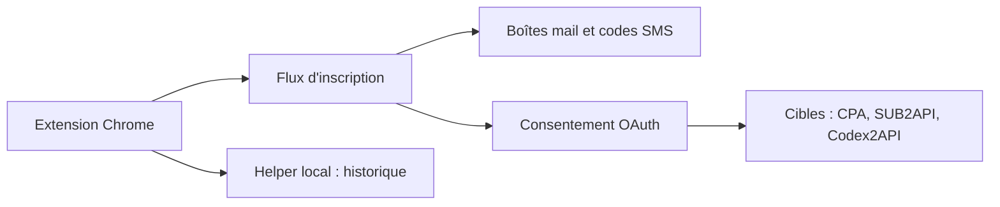

# QLHazyCoder/FlowPilot

> Extension Chrome qui automatise en masse l'inscription et l'autorisation de comptes ChatGPT/OpenAI, Kiro et Grok.

## Le problème
Le README (en chinois) ne l'énonce pas ; l'outil sert à créer des comptes en volume et à les livrer à des passerelles d'API tierces.

## Ce que ça fait vraiment
Panneau latéral qui enchaîne inscription par e-mail, récupération des codes de vérification (nombreux services de messagerie, SMS), consentement OAuth et livraison des comptes vers CPA, SUB2API, Codex2API, webchat, ChatGPT2API ; flux séparés pour Kiro et Grok. Relances automatiques, panneau d'historique, proxys. Le README contient une publicité pour un fournisseur de proxys résidentiels avec code promo.

## Comment c'est branché


## Essayer
```bash
# Aucune commande : chrome://extensions → mode développeur
# → « Charger l'extension non empaquetée » → choisir le dossier du projet
```

## Coût et pièges
Proxys, boîtes mail et numéros de téléphone sont à ta charge. L'inscription automatisée en masse contrevient très probablement aux conditions des plateformes visées (à vérifier) : risque de bannissement.

## Ce que ce n'est pas
Pas un outil de productivité neutre ni un outil de données : il crée des comptes en série. Pas de documentation d'architecture en anglais.

## Alternatives
Aucune alternative nommée dans le README.

## Pour toi
À ignorer : usage de contournement des plateformes, sans valeur pour un profil data/IA et avec un risque de conformité réel.

