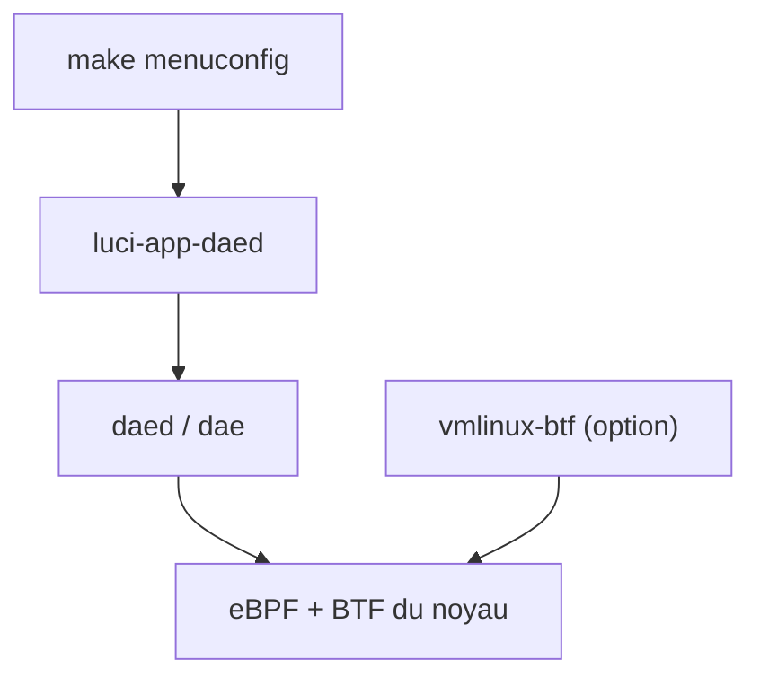

# QiuSimons/luci-app-daed

> LuCI interface for OpenWrt that drives daed, a high-performance transparent proxy built on eBPF.

## The problem
Configuring the dae transparent proxy on an OpenWrt router without a web interface is tedious.

## What it actually does
Compiled inside the OpenWrt tree (`package/dae`). The kernel must enable eBPF and BTF (`CONFIG_KERNEL_DEBUG_INFO_BTF=y`...). The README describes two BTF sources: the kernel's own, recommended, or the `vmlinux-btf` package, and explains how to skip this dependency.

## How it is wired
Simplified diagram based on the sheet, no diagram provided.


## Trying it
```bash
apt-get update
apt-get install -y clang llvm npm
npm install -g pnpm
git clone https://github.com/QiuSimons/luci-app-daed package/dae
make menuconfig
make package/dae/luci-app-daed/compile V=s
```

## Cost and gotchas
Free, but you need a build host with Clang/LLVM and a reconfigured OpenWrt kernel. The repository is archived and has no declared license. The documentation is in Chinese.

## What it is not
Not a standalone proxy: only the interface of other software, for OpenWrt.

## Alternatives
No alternative named in the README.

## For you
Ignore: OpenWrt router tool, archived and outside the data/AI/MLOps scope.
