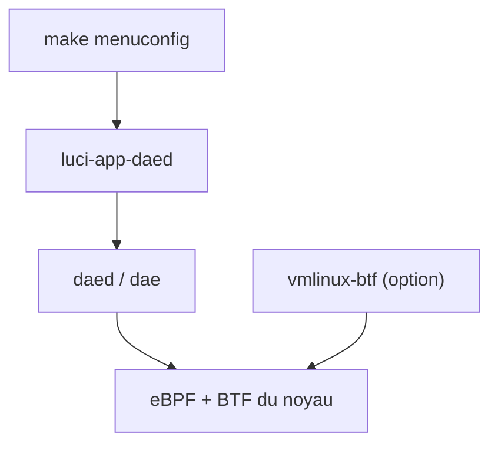

# QiuSimons/luci-app-daed

> Interface LuCI pour OpenWrt qui pilote daed, un proxy transparent à haute performance fondé sur eBPF.

## Le problème
Configurer le proxy transparent dae sur un routeur OpenWrt sans interface web est fastidieux.

## Ce que ça fait vraiment
Se compile dans l'arborescence OpenWrt (`package/dae`). Le noyau doit activer eBPF et BTF (`CONFIG_KERNEL_DEBUG_INFO_BTF=y`...). Le README décrit deux sources de BTF : celle du noyau, recommandée, ou le paquet `vmlinux-btf`, et explique comment ignorer cette dépendance.

## Comment c'est branché
Schéma simplifié d'après la fiche, sans diagramme fourni.


## Essayer
```bash
apt-get update
apt-get install -y clang llvm npm
npm install -g pnpm
git clone https://github.com/QiuSimons/luci-app-daed package/dae
make menuconfig
make package/dae/luci-app-daed/compile V=s
```

## Coût et pièges
Gratuit, mais il faut un hôte de compilation avec Clang/LLVM et un noyau OpenWrt reconfiguré. Le dépôt est archivé et sans licence déclarée. La documentation est en chinois.

## Ce que ce n'est pas
Pas un proxy autonome : seulement l'interface d'un autre logiciel, pour OpenWrt.

## Alternatives
Aucune alternative nommée dans le README.

## Pour toi
À ignorer : outil de routeur OpenWrt, archivé et hors du périmètre data/IA/MLOps.

