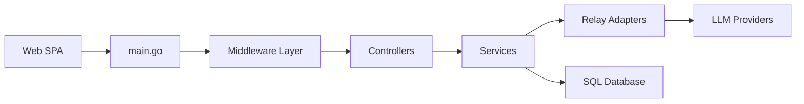

# QuantumNous/new-api

> Self-hosted AI platform that unifies multiple LLM providers behind a single API, for teams.

## The problem
Each client must be reconfigured every time the supplier changes, and the quotas, keys, and costs are scattered across different systems.

## What it actually does
Exposes the OpenAI (Chat, Responses), Anthropic Messages, and Gemini APIs, with protocol conversion (using RelayKit).
Routing through channels with priorities, weights, retries, and multiple keys.
Quotas, subscriptions, usage logs, pricing; users, groups, OAuth/OIDC, 2FA.
Backend: Go/Gin, React console; SQLite, MySQL, or PostgreSQL, Redis (optional).

## How it is wired


## Trying it
```bash
mkdir -p data
docker run --name new-api -d --restart unless-stopped \
  -p 127.0.0.1:3000:3000 \
  -e TZ=Asia/Shanghai \
  -v "$(pwd)/data:/data" \
  calciumion/new-api:latest
curl --fail-with-body http://localhost:3000/v1/models \
  -H "Authorization: Bearer ${NEW_API_KEY}"
```

## Cost and gotchas
Upstream keys are your responsibility to obtain and manage legally. In production: HTTPS, persistent `SESSION_SECRET`, Redis shared across multiple nodes.

## What it is not
Not a template provider. Protocol conversion is not always exact. AGPL-3.0.

## Alternatives
- One API: The original project from which New API is derived.

## For you
Useful for a team to centralize access to LLMs; be aware of the AGPL license if you expose it.
