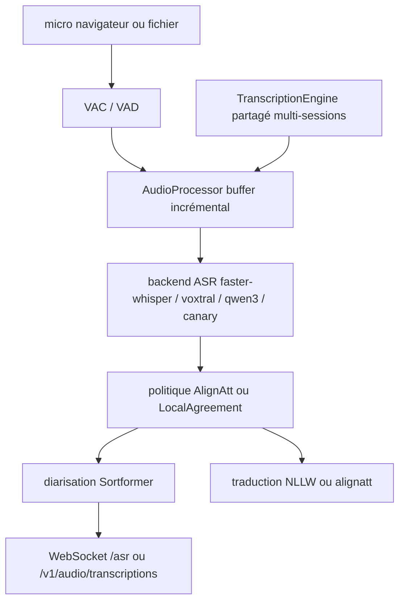

# QuentinFuxa/WhisperLiveKit

> Streaming transcription and translation server, with diarization and OpenAI- and Deepgram-compatible APIs.

## The problem
Whisper is built for complete utterances: cutting it into small chunks loses context and splits words in two.
Going real-time requires a simultaneous decoding policy, not just finer chunking.

## What it actually does
Implements streaming policies from research: SimulStreaming/AlignAtt, LocalAgreement, Sortformer for diarization, NLLW for translation into 200 languages, AlignAtt4LLM for translation by decoder-only LLM.
Interchangeable ASR backends: faster-whisper, whisper, mlx-whisper, `openai-api`, FunASR/SenseVoiceSmall, Voxtral (MLX or HF), Qwen3-ASR (vLLM, vLLM Metal, or HF streaming with causal mode), Canary-1b-v2 via NeMo.
Three network surfaces: OpenAI-compatible REST (`/v1/audio/transcriptions`), Deepgram-compatible WebSocket, native `/asr` WebSocket with per-session parameters (`language`, `target_language`, `context`, `mode=diff`, `token`).
`wlk` CLI to serve, transcribe a file, generate SRTs, manage models and benchmark (`wlk bench`); VAD/VAC to reduce cost when nobody is speaking.

## How it is wired


## Trying it
```bash
pip install whisperlivekit
wlk --model base --language en
wlk run whisper:tiny
wlk transcribe meeting.wav
wlk transcribe --format srt podcast.mp3 -o podcast.srt
wlk models
wlk bench
uv sync --extra cu129 --extra diarization-sortformer
docker build -t wlk .
docker run --gpus all -p 8000:8000 --name wlk wlk
gunicorn -k uvicorn.workers.UvicornWorker -w 4 your_app:app
```

## Cost and gotchas
Free and local, but several heavy extras are mutually incompatible and must live in separate environments — the reference list is `[tool.uv].conflicts` in `pyproject.toml`.
Qwen3 causal mode is English only; `--language auto` biases toward English; Diart diarization is limited to Python 3.11-3.12 and requires accepting the pyannote conditions then `huggingface-cli login`. Plan for one real-time session per GPU.

## What it is not
Not a simple Whisper wrapper: the README explains why calling Whisper on each batch does not work.
Not a tool for simultaneous speakers: Sortformer produces overlapping probabilities, but each token is assigned to a single speaker.
Not a hosted service: the OpenAI and Deepgram compatibilities are subsets, not the full APIs.

## Alternatives
- Simul-Whisper, WhisperStreaming, Streaming Sortformer, NLLB/NLLW, Qwen3-ASR-causal: the works whose policies it implements.

## For you
The best candidate in this batch for self-hosted real-time transcription; start with a single profile of extras.
