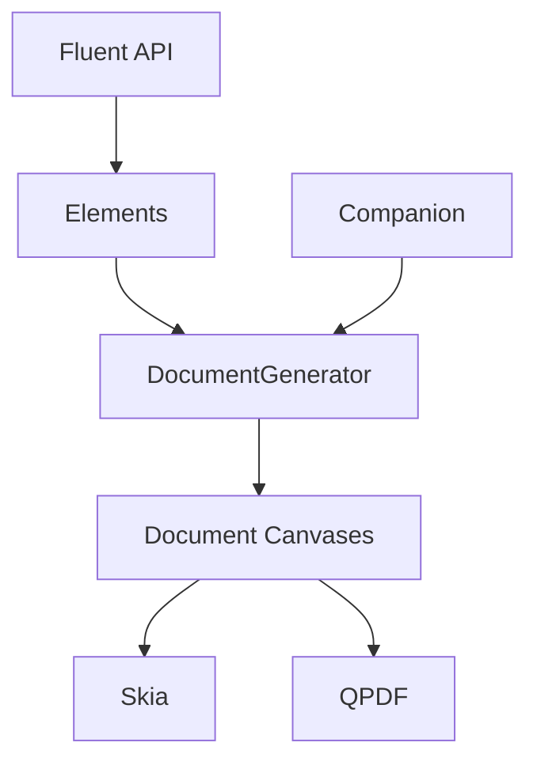

# QuestPDF/QuestPDF

> C# library for generating PDFs from typed code, for .NET developers.

## The problem
Generating PDF invoices and reports via HTML means fighting with CSS and browser differences.

## What it actually does
Fluent C# API that composes a tree of elements, computes layout and pagination, then renders the result through Skia to PDF, SVG, image or XPS. PDF operations via qpdf: merging, page extraction, encryption, attachments. Compliance with PDF/A, PDF/UA, ZUGFeRD and Factur-X. A companion app offers hot-reload preview. No external calls.

## How it is wired


## Trying it
```bash
dotnet add package QuestPDF
```
```csharp
Document.Create(container => { /* page, header, content */ }).GeneratePdf("hello.pdf");
```

## Cost and gotchas
Free for individuals, nonprofits, open-source projects and organizations under $1M annual revenue, paid beyond that. License not identified by GitHub: read it before use. Targets .NET 6+ and .NET Framework 4.6.2+.

## What it is not
Not an HTML-to-PDF converter. Not open source in the classic sense: the code is viewable but the license is conditional.

## Alternatives
- No alternative named in the README.

## For you
Ignore: reserved for .NET projects and subject to a revenue-based license; a Python profile gets nothing from it.
