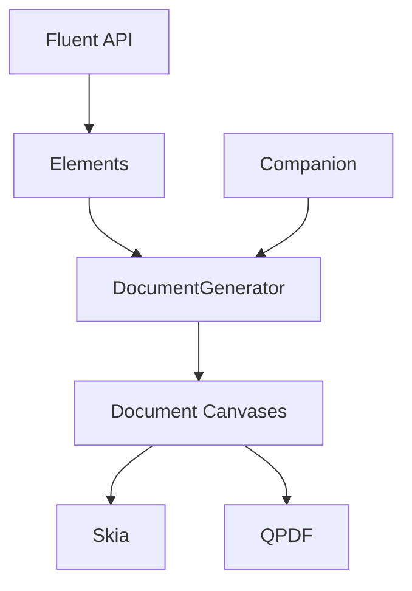

# QuestPDF/QuestPDF

> Bibliothèque C# pour générer des PDF en code typé, pour les développeurs .NET.

## Le problème
Générer des factures et rapports PDF via HTML demande de lutter avec le CSS et les différences de navigateur.

## Ce que ça fait vraiment
API fluide en C# qui compose un arbre d'éléments, calcule la mise en page et la pagination, puis rend le résultat via Skia en PDF, SVG, image ou XPS. Opérations PDF via qpdf : fusion, extraction de pages, chiffrement, pièces jointes. Conformité PDF/A, PDF/UA, ZUGFeRD et Factur-X. Une application compagnon offre l'aperçu à chaud. Aucun appel externe.

## Comment c'est branché


## Essayer
```bash
dotnet add package QuestPDF
```
```csharp
Document.Create(container => { /* page, header, content */ }).GeneratePdf("hello.pdf");
```

## Coût et pièges
Gratuit pour particuliers, associations, projets open source et organisations sous 1 M$ de chiffre d'affaires annuel, payant au-delà. Licence non identifiée par GitHub : à lire avant usage. Cible .NET 6+ et .NET Framework 4.6.2+.

## Ce que ce n'est pas
Pas un convertisseur HTML vers PDF. Pas libre au sens open source classique : le code est consultable mais la licence est conditionnelle.

## Alternatives
- Aucune alternative nommée dans le README.

## Pour toi
À ignorer : réservé aux projets .NET et soumis à une licence selon le chiffre d'affaires ; un profil Python n'en tire rien.

