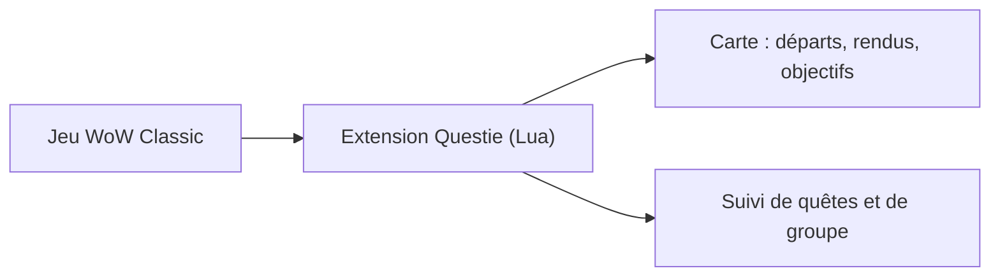

# Questie/Questie

> World of Warcraft Classic addon that shows quests, objectives and tracking on the map.

## The problem
The Classic game shows little information about quests.

## What it actually does
Displays quest starts, turn-ins and objectives on the map, NPC routes, quest tracking, group progress, a journey log, quests by zone, database search, many options. Translations for Classic's official languages. An API to integrate Questie with other addons.

## How it is wired
Simplified diagram based on the sheet, no diagram provided.



## Trying it
```bash
luacheck -q Database Localization Modules Questie.lua
busted -p ".test.lua" .
lua cli/validate-loader-usage.lua
```

## Cost and gotchas
Free; requires the game. Development: Lua 5.1, luarocks, busted, luacheck.

## What it is not
Not a productivity or data tool: it is an extension for the World of Warcraft Classic game, of no interest for your work.

## Alternatives
No alternative named in the README.

## For you
Ignore: a game addon, outside data/AI/MLOps.
