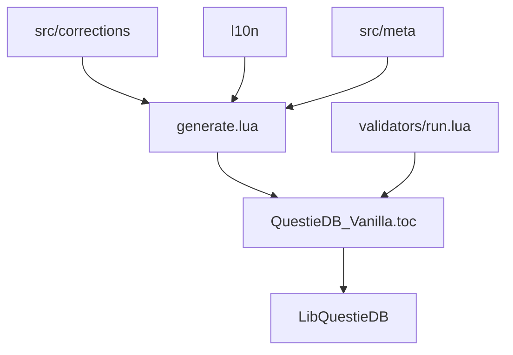

# Questie/QuestieDB

> Database of World of Warcraft quests, NPCs and items in TOC format, for addon authors.

## The problem
A WoW addon must read thousands of game entities without disk access or large Lua files.

## What it actually does
Stores the data of six game variants (Vanilla, TBC, Wrath, Cata, Mists, Forever) in TOC file metadata, read at runtime. Two modes: source (committed TOC) or baked (generated artifacts, with translations in CBOR blocks). An offline generator in Lua 5.1, validators and a Python orchestrator produce and verify the artifacts; the API is described in `docs/api.md`.

## How it is wired
Simplified diagram based on the sheet, no diagram provided.



## Trying it
```sh
./generate.sh Vanilla
lua5.1 verify.lua Vanilla
lua5.1 validators/run.lua Vanilla
./questiedb.sh generate Vanilla
./questiedb.sh package all
```

## Cost and gotchas
Lua 5.1 is provided on Windows and Linux x64; the full orchestrator requires Python 3.8+. Generating all flavors takes several minutes and up to about 2 GB of memory. License: the README cites `LICENSE.md` and `gpl-3.0.md`, but GitHub does not identify it. README truncated in the material provided.

## What it is not
Not a complete quest addon: it is the database consumed by Questie. Without a WoW client, it is useless.

## Alternatives
None cited in the README.

## For you
Ignore: World of Warcraft-specific data, unrelated to data / AI / MLOps work.
