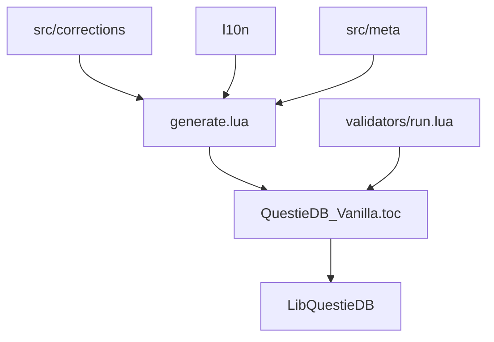

# Questie/QuestieDB

> Base de données de quêtes, PNJ, objets World of Warcraft au format TOC, pour auteurs d'addons.

## Le problème
Un addon WoW doit lire des milliers d'entités du jeu sans accès disque ni gros fichiers Lua.

## Ce que ça fait vraiment
Stocke les données de six variantes du jeu (Vanilla, TBC, Wrath, Cata, Mists, Forever) dans les métadonnées de fichiers TOC, lues à l'exécution. Deux modes : source (TOC committé) ou baked (artefacts générés, avec traductions en blocs CBOR). Un générateur hors ligne en Lua 5.1, des validateurs et un orchestrateur Python produisent et vérifient les artefacts ; l'API est décrite dans `docs/api.md`.

## Comment c'est branché
Schéma simplifié d'après la fiche, sans diagramme fourni.



## Essayer
```sh
./generate.sh Vanilla
lua5.1 verify.lua Vanilla
lua5.1 validators/run.lua Vanilla
./questiedb.sh generate Vanilla
./questiedb.sh package all
```

## Coût et pièges
Lua 5.1 est fourni sur Windows et Linux x64 ; l'orchestrateur complet exige Python 3.8+. La génération de tous les flavors prend plusieurs minutes et jusqu'à environ 2 Go de mémoire. Licence : le README cite `LICENSE.md` et `gpl-3.0.md`, mais GitHub ne l'identifie pas. README tronqué dans la matière fournie.

## Ce que ce n'est pas
Pas un addon de quêtes complet : c'est la base consommée par Questie. Sans client WoW, il ne sert à rien.

## Alternatives
Aucune citée dans le README.

## Pour toi
À ignorer : donnée spécifique à World of Warcraft, sans lien avec un travail data / IA / MLOps.

