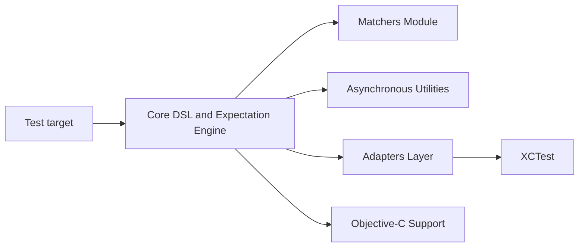

# Quick/Nimble

> Matcher library for expressing expectations in Swift and Objective-C tests.

## The problem
XCTest assertions are verbose; you want readable expectations, including asynchronous ones.

## What it actually does
An `expect(...).to(...)` DSL built on `Expectation`/`Expression` and a large set of matchers. Adapters link XCTest and Swift Testing, an Objective-C layer serves ObjC tests, and helpers handle `toEventually`. Installation via Swift Package Manager, CocoaPods, Carthage or git submodules.

## How it is wired


## Trying it
```bash
pod install
```
(after adding `pod 'Nimble'` to the Podfile; SwiftPM version: `.package(url: "https://github.com/Quick/Nimble.git", from: "13.0.0")`).

## Cost and gotchas
Free. `raiseException` is not available via Swift Package Manager. Link it to the test target, not the app.

## What it is not
Not a complete test framework: it complements XCTest; the README also presents it as a companion to Quick. It states there is no telemetry.

## Alternatives
- Quick: sibling project, BDD style, installed together with Nimble.

## For you
Ignore for a data/AI/MLOps profile: a Swift/iOS testing tool unrelated to your field.
