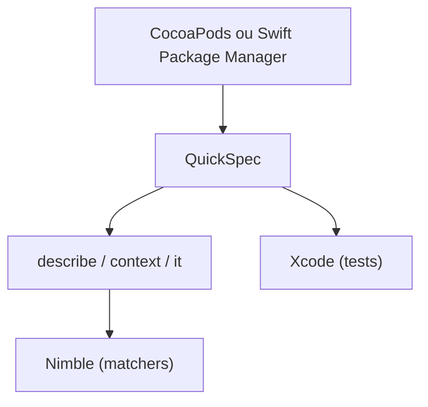

# Quick/Quick

> Behavior-driven testing framework for Swift and Objective-C, for iOS and macOS developers.

## The problem
Raw XCTest assertions make expectations hard to read in Swift tests.

## What it actually does
Tests are described in `describe`, `context` and `it` blocks, inspired by RSpec. It is used with Nimble, which provides the matchers. A table gives the Quick and Nimble versions compatible with each Swift version. No data collection, according to the README.

## How it is wired
Simplified diagram based on the sheet, no diagram provided.



## Trying it
```bash
# Extrait Package.swift du README
# .package(url: "https://github.com/Quick/Quick.git", from: "7.0.0"),
# .package(url: "https://github.com/Quick/Nimble.git", from: "12.0.0"),
# Alternative CocoaPods : pod 'Quick' et pod 'Nimble' dans le Podfile
```

## Cost and gotchas
Free. Swift and Xcode are required, and are missing from the prerequisites list: `[none]`. Never include it in the binary submitted to the App Store: the app would be rejected, because Quick uses private APIs.

## What it is not
Not a general-purpose testing tool: Swift and Objective-C only. Not shipped in the app.

## Alternatives
Nimble, shipped with Quick, for matchers.

## For you
Ignore: Swift testing framework, unrelated to data / AI / MLOps work, unless you have an iOS app to test.
