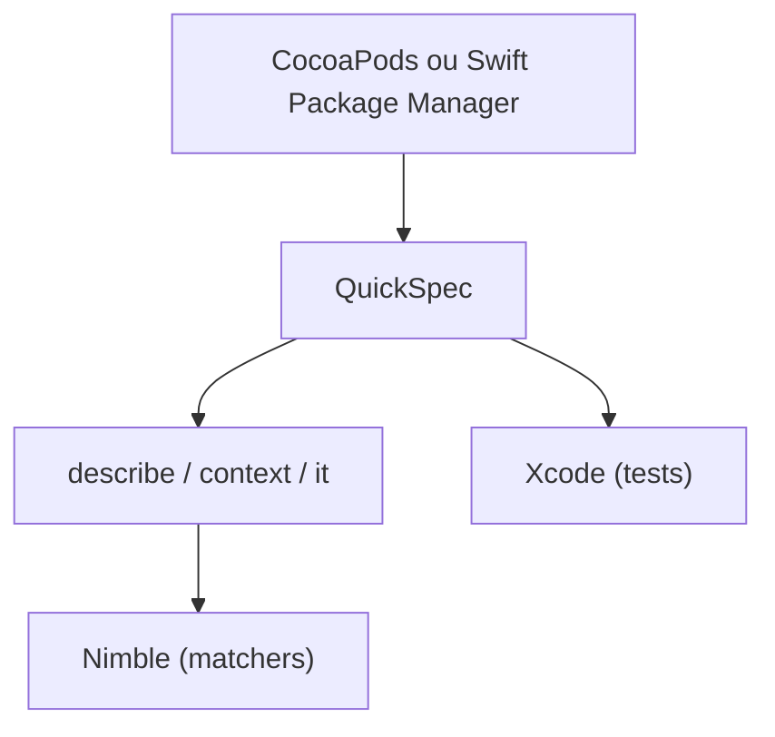

# Quick/Quick

> Framework de tests orientés comportement pour Swift et Objective-C, pour développeurs iOS et macOS.

## Le problème
Les assertions XCTest brutes rendent les attentes peu lisibles dans les tests Swift.

## Ce que ça fait vraiment
On décrit les tests en blocs `describe`, `context`, `it`, inspirés de RSpec. Il s'utilise avec Nimble, qui fournit les matchers. Une table donne les versions de Quick et Nimble compatibles avec chaque version de Swift. Aucune collecte de données, selon le README.

## Comment c'est branché
Schéma simplifié d'après la fiche, sans diagramme fourni.



## Essayer
```bash
# Extrait Package.swift du README
# .package(url: "https://github.com/Quick/Quick.git", from: "7.0.0"),
# .package(url: "https://github.com/Quick/Nimble.git", from: "12.0.0"),
# Alternative CocoaPods : pod 'Quick' et pod 'Nimble' dans le Podfile
```

## Coût et pièges
Gratuit. Il faut Swift et Xcode, absents de la liste des prérequis : `[aucun]`. À ne jamais inclure dans le binaire soumis à l'App Store : l'app serait rejetée, car Quick utilise des API privées.

## Ce que ce n'est pas
Pas un outil de test général : Swift et Objective-C uniquement. Pas livré dans l'app.

## Alternatives
Nimble, livré avec Quick, pour les matchers.

## Pour toi
À ignorer : framework de tests Swift, sans lien avec un travail data / IA / MLOps, sauf application iOS à tester.

