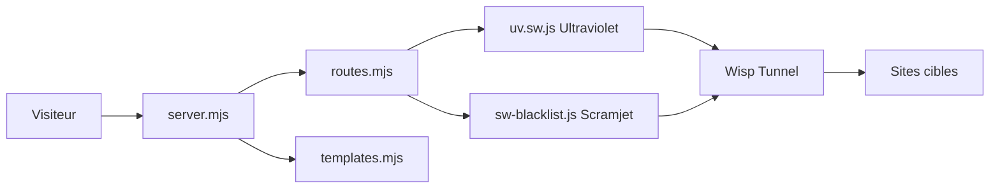

# QuiteAFancyEmerald/InvisiProxy

> Self-hostable web proxy that bypasses browsing filters, aimed mainly at school and university students.

## The problem
Local networks, extensions or firewalls block access to certain sites. The project offers to reach them despite this filtering.

## What it actually does
A web server (fastify) serves pages and service workers that route browsing through two browser proxy engines, Ultraviolet and Scramjet, via the Wisp protocol. It adds ad blocking, tab customization, optional Tor/SOCKS5 routing and web games. The "cloaking" options (source randomization, DOM masking) aim to avoid detection by filters. The implementation of Tor routing and ad blocking is not visible in the described architecture.

## How it is wired


## Trying it
```bash
git clone https://github.com/QuiteAFancyEmerald/InvisiProxy.git
cd InvisiProxy
pnpm run fresh-install
pnpm run fetch-adblock
pnpm start
```

## Cost and gotchas
Node 20.x, git, curl and NGINX (not Caddy, as the README specifies); a VPS or host is needed for real use. The master branch is unstable: the README recommends the production branch.

## What it is not
Not a data/AI tool. The "official links" go through the community's Discord. Bypassing filters may violate the rules of a school, an employer or local law; use is the responsibility of the host and the user. The README calls itself "experimental" and a "proof of concept".

## Alternatives
- Ultraviolet: the proxy engine used internally, to take on its own if you need a single building block.
- Scramjet: the other integrated engine, better CAPTCHA handling according to the README.
- Incognito: another proxy cited by the author in his 2022 message.

## For you
Ignore: it is a filter-bypass proxy unrelated to data, AI or MLOps pipelines, with compliance risks on a work machine.
