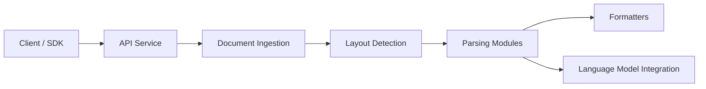

# QuivrHQ/MegaParse

> Document parser (PDF, Word, PowerPoint, Excel, CSV) to structured text, with an optional LLM vision mode.

## The problem
Cleanly extracting tables, headings and layout from varied documents before a RAG pipeline.

## What it actually does
Python library with several parsers (unstructured, doctr, LlamaParse, MegaParse Vision), layout detection via ONNX models, table formatters. Also available as an API (Makefile, docs on localhost:8000). The README publishes an internal benchmark in which MegaParse Vision scores 0.87 similarity.

## How it is wired


## Trying it
```bash
pip install megaparse
make dev
python evaluations/script.py
```

## Cost and gotchas
Poppler and Tesseract must be installed (libmagic on Mac). An OpenAI or Anthropic key is needed for vision mode, which means sending your documents to a third party. The benchmark is supplied by the authors.

## What it is not
Not guaranteed "lossless": that is a stated goal. The work items (modular post-processing, structured output) are still in progress.

## Alternatives
- unstructured and llama_parser: compared in the README benchmark.

## For you
Worth watching: interesting upstream of a RAG, to be tested on your own documents before believing the benchmark.
