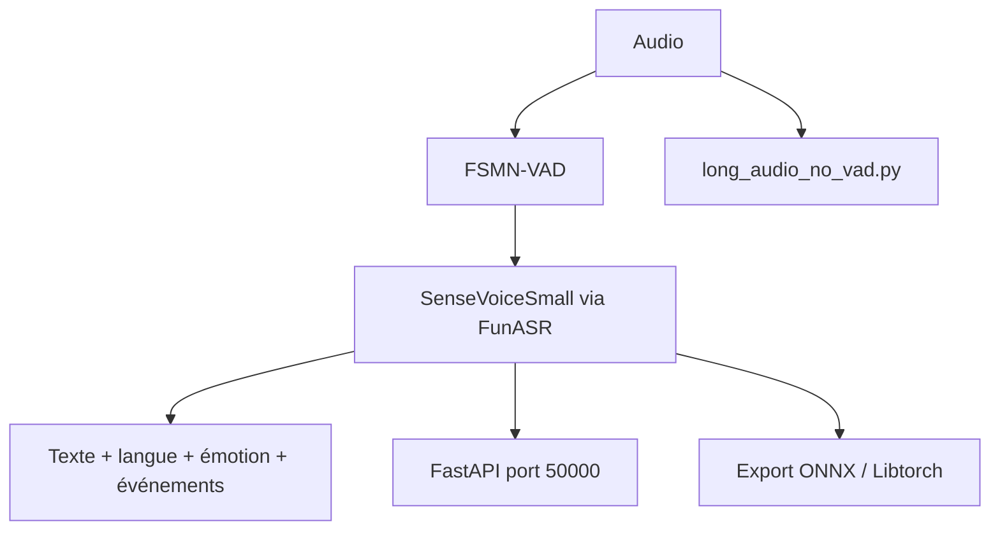

# QwenAudio/SenseVoice

> Speech model that transcribes and also identifies language, emotion and sound events.

## The problem
Transcription alone ignores emotion and noises; Whisper is slow and less accurate in Chinese and Cantonese.

## What it actually does
SenseVoiceSmall covers Mandarin, Cantonese, English, Japanese and Korean, with emotion and event tags. Non-autoregressive architecture: the README claims more than 5 times the speed of Whisper-Small. Inference via FunASR, ONNX/Libtorch export, llama.cpp binary on CPU, FastAPI service, Docker and finetuning scripts. Diarization goes through CAM++, outside the model.

## How it is wired


## Trying it
```bash
pip install -r requirements.txt
fastapi run --port 50000
docker run --rm --gpus all -p 50000:50000 -v sensevoice-models:/models sensevoice
```

## Cost and gotchas
GPU recommended, CPU possible via Docker or GGUF. `trust_remote_code=True` runs local code. The ghcr.io image is private.

## What it is not
Not the "50 languages" of the research: the published checkpoint covers five. Not a diarization model, and the accuracy of this composition is not validated.

## Alternatives
- Whisper (cited): broader language coverage.
- FunASR (cited): complete toolkit with VAD, punctuation, diarization.

## For you
Adopt for fast transcription in Chinese or limited multilingual use: simple deployment and varied export formats.
