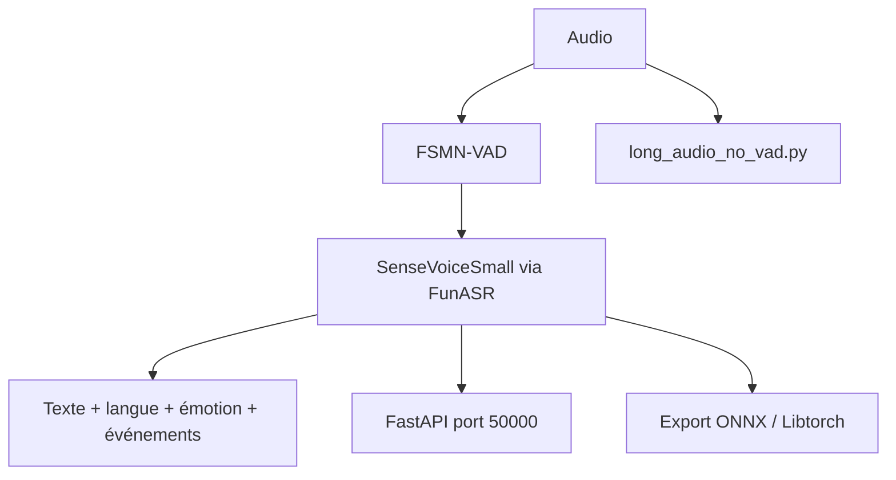

# QwenAudio/SenseVoice

> Modèle de parole qui transcrit, identifie la langue, l'émotion et les événements sonores.

## Le problème
La transcription seule ignore l'émotion et les bruits ; Whisper est lent et moins précis en chinois et cantonais.

## Ce que ça fait vraiment
SenseVoiceSmall couvre mandarin, cantonais, anglais, japonais et coréen, avec étiquettes d'émotion et d'événements. Architecture non autorégressive : le README annonce plus de 5 fois la vitesse de Whisper-Small. Inférence via FunASR, export ONNX/Libtorch, binaire llama.cpp en CPU, service FastAPI, Docker et scripts de finetuning. La diarisation passe par CAM++ en dehors du modèle.

## Comment c'est branché


## Essayer
```bash
pip install -r requirements.txt
fastapi run --port 50000
docker run --rm --gpus all -p 50000:50000 -v sensevoice-models:/models sensevoice
```

## Coût et pièges
GPU conseillé, CPU possible via Docker ou GGUF. `trust_remote_code=True` exécute du code local. L'image ghcr.io est privée.

## Ce que ce n'est pas
Pas les « 50 langues » de la recherche : le checkpoint publié en couvre cinq. Pas un modèle de diarisation, et la précision de cette composition n'est pas validée.

## Alternatives
- Whisper (cité) : couverture linguistique plus large.
- FunASR (cité) : boîte à outils complète VAD, ponctuation, diarisation.

## Pour toi
À adopter pour de la transcription rapide en chinois ou multilingue limité : déploiement simple et formats d'export variés.

