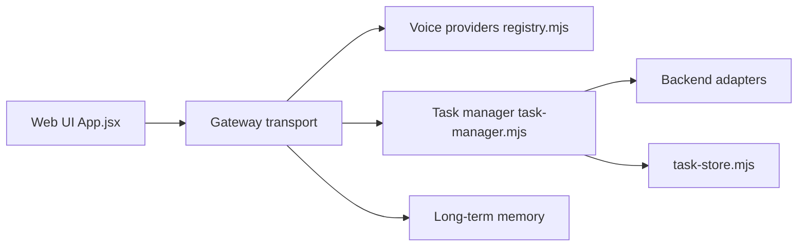

# QwenAudio/qwen-audio-agent

> Real-time voice runtime that lets you converse while a coding agent works in the background.

## The problem
A classic voice agent goes silent as soon as it calls a tool or launches a long task.

## What it actually does
A gateway connects a real-time voice front end (Qwen Audio, OpenAI Realtime, Gemini Live, Doubao, StepAudio, or Hugging Face Speech-to-Speech locally) to a backend agent via ACP (Qwen Code, OpenCode, Claude Code, Codex, etc.). Simple questions are handled right away; the rest is delegated, tracked, and the result comes back into the conversation. Interfaces: WebUI, TUI, floating desktop bubble, long-term memory per user.

## How it is wired


## Trying it
```bash
npm install -g qwen-audio-agent
qwenaudio config
qwenaudio        # Terminal 1 : Gateway
qwenaudio tui    # Terminal 2 : TUI
```

## Cost and gotchas
DashScope (Bailian) key by default, or the key of the chosen provider; billing according to their rules. Node 22.22.2+ or 24.15.0+.

## What it is not
Not a voice model: it orchestrates existing voice services. The cockpit, embedded and livestream cases are only partly "planned".

## Alternatives
No alternative named in the README.

## For you
Worth watching: the "conversation + asynchronous tasks" pattern is instructive for voice agents, but the repo is recent (created in July 2026) and depends on cloud keys.
