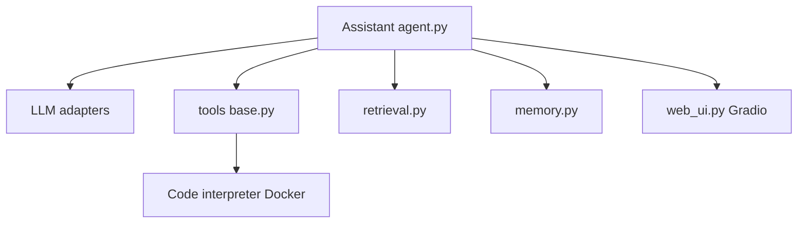

# QwenLM/Qwen-Agent

> Python framework for LLM agents (tools, RAG, MCP) designed for Qwen models.

## The problem
To build an agent that calls tools, reads documents and runs code, you have to write the function-calling parsing for each model yourself.

## What it actually does
It provides the `Agent`, `BaseChatModel` and `BaseTool` classes, with function calling, parallel calls and MCP tools.
Built-in tools cover search, RAG over long documents and a code interpreter in Docker.
It handles memory, multi-agent setups (`multi_agent_hub.py`) and a Gradio interface (`WebUI`).
It works with DashScope or any OpenAI-compatible endpoint (vLLM, Ollama). It is the backend of Qwen Chat.

## How it is wired


## Trying it
```bash
pip install -U "qwen-agent[gui,rag,code_interpreter,mcp]"
pip install -U qwen-agent
```

## Cost and gotchas
You need a DashScope key (`DASHSCOPE_API_KEY`) or a model server to host yourself. The code interpreter requires Docker, and the README notes that its isolation is only "basic".

## What it is not
It is not a vendor-agnostic framework: it is optimized for Qwen. The last push dates from 2026-03-04 and there are 538 open issues.

## Alternatives
The README names no alternative repository.

## For you
Worth watching: a good choice if you deploy Qwen models via vLLM, but for a multi-provider project other frameworks remain more neutral.
