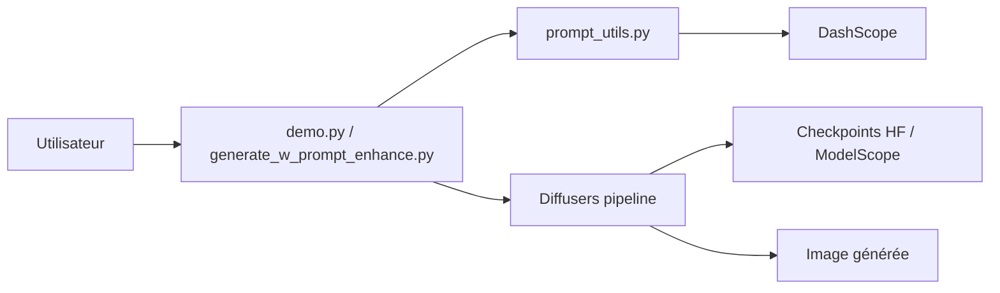

# QwenLM/Qwen-Image

> Open 20B model for generating and editing images, especially with text in them.

## The problem
Open source image models render text poorly, especially Chinese, and edit an image without preserving the subject's identity.

## What it actually does
The repository contains docs, example scripts and prompt-rewriting utilities: the weights and the engine are elsewhere (Diffusers, `Qwen/Qwen-Image*` checkpoints).
It covers several variants: T2I, Edit, Edit-2509/2511 (multi-image), 2512 (realism).
`prompt_utils.py` rewrites prompts via DashScope (Qwen service, optional).
`demo.py` launches a multi-GPU Gradio server with a queue.

## How it is wired


## Trying it
```bash
pip install git+https://github.com/huggingface/diffusers
cd src
DASHSCOPE_API_KEY=sk-xxxxxxxxxxxxxxxxx python examples/demo.py
```

## Cost and gotchas
A substantial GPU is required (20B parameters; DiffSynth claims inference is possible under 4 GB with offload). Prompt enhancement requires a paid DashScope key.

## What it is not
No training code or model implementation here. LoRA/finetuning support in Diffusers is announced as "coming soon".

## Alternatives
- DiffSynth-Studio: low-VRAM offload, FP8, LoRA training.
- SGLang-Diffusion: serve the model as soon as it is released.
- cache-dit: speed up inference through caching.

## For you
Worth watching: it is a real open option for generating or editing visuals containing text, but real use goes through Diffusers and requires a GPU.
