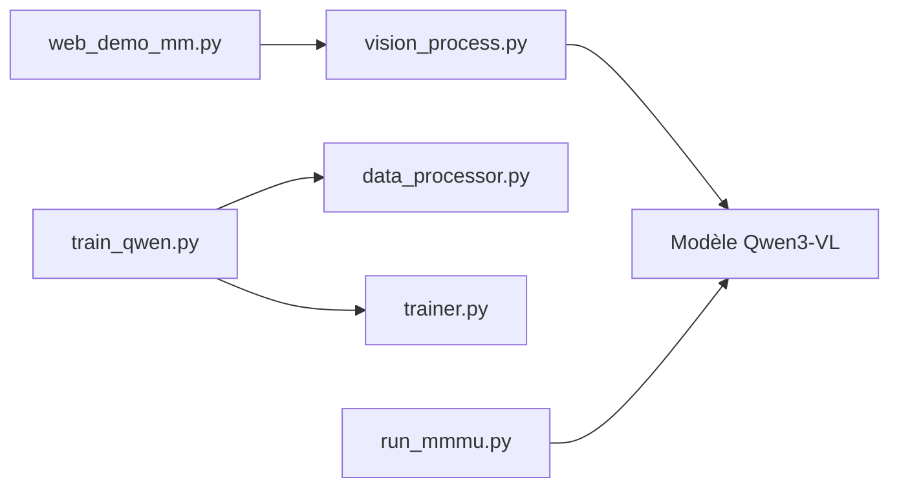

# QwenLM/Qwen2-VL

> Repository of the Qwen3-VL vision-language model (text, image, video), for developers of multimodal applications.

## The problem
Reading documents, images and videos with an LLM requires a multimodal model and a suitable preprocessing pipeline.

## What it actually does
Publishes Qwen3-VL (dense and MoE, Instruct and Thinking editions): OCR in 32 languages, 2D/3D grounding, GUI agent, 256K context extensible to 1M, video. The repository contains transformers examples, the `qwen-vl-utils` tool, a web demo, fine-tuning and evaluations (MMMU, MathVision, ODinW, RealWorldQA, VideoMME). Deployment via vLLM or SGLang.

## How it is wired


## Trying it
```bash
pip install "transformers>=4.57.0"
pip install qwen-vl-utils==0.0.14
pip install -r requirements_web_demo.txt
python web_demo_mm.py -c /your/path/to/qwen3vl/weight
```

## Cost and gotchas
GPU required; the 235B model needs a multi-GPU server (vLLM example on H100 with tensor-parallel 8). The DashScope API requires a key. The VRAM table in the README applies to Qwen2.5-VL.

## What it is not
It is not only Qwen2-VL despite the repository name: the README is that of Qwen3-VL. Cookbooks announced as "in preparation".

## Alternatives
Not documented: the README names no alternative.

## For you
Adopt for OCR and extraction on documents: Apache-2.0 and models in various sizes; plan for a sufficient GPU.
