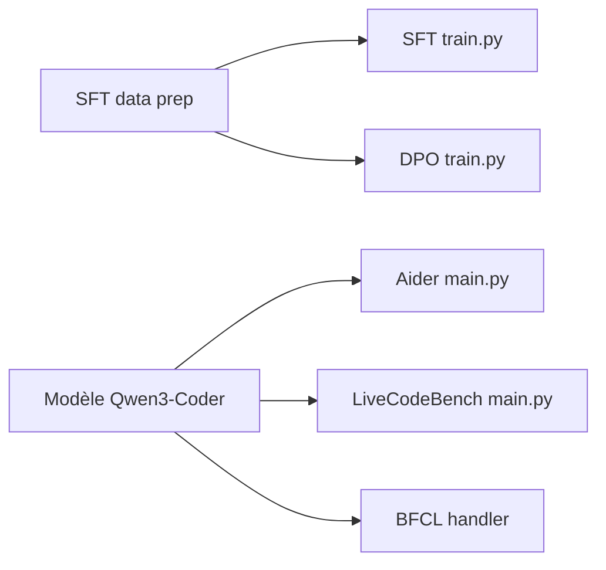

# QwenLM/Qwen2.5-Coder

> Repository of the Qwen3-Coder code models and the associated training and evaluation tools.

## The problem
A code model for agents must handle long context, tool calls and dozens of languages.

## What it actually does
Announces Qwen3-Coder (480B-A35B, 30B-A3B, Next): 256K context extensible to 1M via YaRN, 358 languages, fill-in-the-middle, tool calls for Qwen Code, Cline, Claude Code. The repository contains fine-tuning (SFT, DPO) and evaluation suites (Aider, Bird-Spider, LiveCodeBench, CRUXEval, BFCL, Tau).

## How it is wired


## Trying it
```python
from transformers import AutoModelForCausalLM, AutoTokenizer
model_name = "Qwen/Qwen3-Coder-Next"
model = AutoModelForCausalLM.from_pretrained(model_name, torch_dtype="auto", device_map="auto")
tokenizer = AutoTokenizer.from_pretrained(model_name)
```

## Cost and gotchas
Significant GPU and memory. The tool parser requires vLLM or SGLang. No license declared on the repository: usage rights to be checked.

## What it is not
It is not the Qwen2.5-Coder of the repository's name: the README presents Qwen3-Coder. It is not a finished application.

## Alternatives
Not documented: the README names no alternative.

## For you
Keep watching: open code model for agents, but the absence of a license on the repository means you must read the weights' licenses before use.
