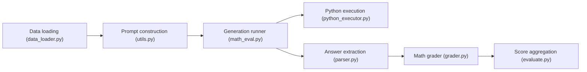

# QwenLM/Qwen2.5-Math

> Family of Qwen models specialized in mathematics (CoT and TIR), in English and Chinese, for researchers.

## The problem
General-purpose LLMs solve competition-level math problems poorly and do not make good use of computation by code.

## What it actually does
Publishes base models at 1.5B/7B/72B, their instruct versions and a 72B reward model (Qwen2.5-Math-RM-72B). Two modes: chain of thought and reasoning that integrates Python code (TIR). The repository also contains the evaluation harness (dataset loading, prompts, Python executor, answer extraction and comparison, majority voting and RM).

## How it is wired


## Trying it
```bash
cd latex2sympy
pip install -e .
cd ..
pip install -r requirements.txt
bash sh/eval.sh $PROMPT_TYPE $MODEL_NAME_OR_PATH
```
Inference: `transformers>=4.37.0`, model `Qwen/Qwen2.5-Math-72B-Instruct`.

## Cost and gotchas
The 72B requires several GPUs (the eval command uses 4). Reproduction requires pinned versions (`vllm==0.5.1`, `transformers` 4.42.3). Repository with no declared license; last push in January 2025.

## What it is not
The authors advise against using these models for any task other than math. The scores cited are the authors' own.

## Alternatives
No alternative named in the README.

## For you
Worth watching: useful as a reference for a math model and an eval harness, but check the weights' license (not specified here) and note that the repository is no longer active.
