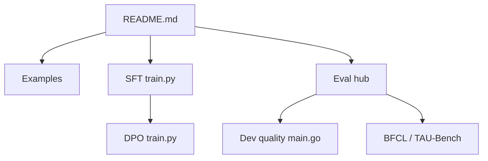

# QwenLM/Qwen3-Coder

> Home page of the open-weight Qwen3-Coder code models, with their evaluations.

## The problem
You need an open code model, able to play an agent role, and that runs locally at a reasonable cost.

## What it actually does
Three models: Qwen3-Coder-480B-A35B, 30B-A3B and Next (80B-A3B, hybrid attention and MoE). 256K context, extensible to 1M.
They handle FIM (`<|fim_prefix|>`) and a dedicated tool-call format, with parsers for SGLang and vLLM.
The repository contains examples, SFT/DPO pipelines and a large evaluation bench (`qwencoder-eval`, BFCL, TAU-Bench).
The weights are published on Hugging Face and ModelScope.

## How it is wired

## Trying it
The README gives no shell command. It only provides Python examples with `transformers`.

## Cost and gotchas
The models are large: you need VRAM, unless you use the FP8 or GGUF variants. The special tokens changed, so the new tokenizer is required.

## What it is not
It is not an installable tool. The repository does not contain the weights. No license is declared in the catalog.

## Alternatives
The README names no alternative repository. It cites Qwen Code, CLINE and Claude Code as compatible clients.

## For you
Worth watching: Qwen3-Coder-Next is a serious candidate for a local code assistant, but check the weights' license before any use.
