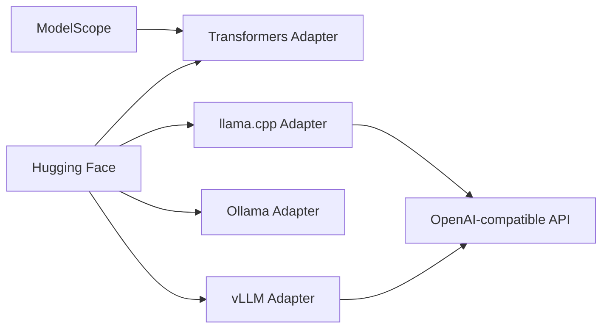

# QwenLM/Qwen3

> Reference repository of the Qwen3 open-weight LLM family: docs, inference examples and deployment.

## The problem
Choosing and serving an open LLM requires knowing the right parameters for each engine (templates, reasoning, long context).

## What it actually does
Documents the dense and MoE models (0.6B to 235B-A22B) and the 2507 update (Instruct and Thinking, 256K context extensible to 1M).
Provides Transformers snippets and commands for llama.cpp, Ollama, SGLang, vLLM, TensorRT-LLM.
Explains how to switch between thinking and non-thinking (`enable_thinking`, `/think`).
The weights are on Hugging Face and ModelScope; the repository contains docs, Dockerfiles and examples.

## How it is wired


## Trying it
```bash
ollama run qwen3:8b
vllm serve Qwen/Qwen3-8B --port 8000 --max-model-len 131072 --enable-reasoning --reasoning-parser qwen3
```

## Cost and gotchas
Free, but large sizes need a lot of GPU and memory. Ollama's default `num_ctx` is 2048 and must be raised. vLLM/SGLang degrade multi-step tool use in thinking mode.

## What it is not
Not the training code. No license declared at the repository level: check the license of each checkpoint.

## Alternatives
- Qwen-Agent: recommended layer on top for tool use and MCP.

## For you
Adopt: the reference family of open models for local or self-hosted use, with ready-made serving recipes for vLLM and Ollama.
