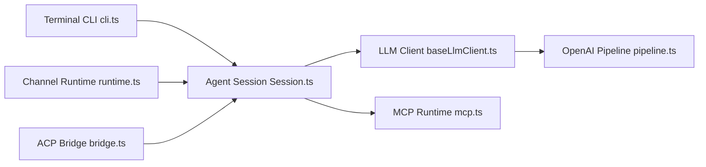

# QwenLM/qwen-code

> Open-source coding agent for terminal, editor, desktop, browser and messaging apps.

## The problem
Popular coding agents are tied to one vendor; you need an agent compatible with several protocols and local models.

## What it actually does
Command-line agent (`qwen`) with sub-agents, agent teams, automatic memory and skills, MCP, plan mode, hooks and LSP. OpenAI, Anthropic, Gemini, Qwen protocols and local models (Ollama, vLLM). Other surfaces: desktop app, Web interface (`qwen serve`, experimental), IDE plugins, TypeScript/Python/Java SDKs and Telegram, DingTalk, WeChat, Feishu channels. Originally based on Gemini CLI v0.8.2.

## How it is wired


## Trying it
```bash
npm install -g @qwen-code/qwen-code@latest
cd /path/to/your-project
qwen
qwen -p "..."
```

## Cost and gotchas
Node 22+; provider and key to configure via `/auth`. The standalone install script is hosted on Alibaba Cloud object storage. 2,055 open issues.

## What it is not
The parity table with Claude Code is a comparison declared by the team. The cited SWE-bench evaluation (76.4 to 77.8%) relies on a specific model that may not be available to you.

## Alternatives
Claude Code (README comparison); Gemini CLI (origin of the code).

## For you
Worth watching: multi-protocol agent relevant if you want to test open models in an agent workflow, with a lot of experimental surface.
