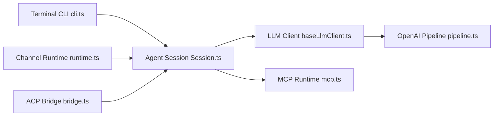

# QwenLM/qwen-code

> Agent de code open source pour terminal, éditeur, bureau, navigateur et messageries.

## Le problème
Les agents de code populaires sont liés à un fournisseur ; il faut un agent compatible avec plusieurs protocoles et modèles locaux.

## Ce que ça fait vraiment
Agent en ligne de commande (`qwen`) avec sous-agents, équipes d'agents, mémoire et compétences automatiques, MCP, mode plan, hooks et LSP. Protocoles OpenAI, Anthropic, Gemini, Qwen et modèles locaux (Ollama, vLLM). Autres surfaces : application de bureau, interface Web (`qwen serve`, expérimental), plugins IDE, SDK TypeScript/Python/Java et canaux Telegram, DingTalk, WeChat, Feishu. Basé sur Gemini CLI v0.8.2 à l'origine.

## Comment c'est branché


## Essayer
```bash
npm install -g @qwen-code/qwen-code@latest
cd /path/to/your-project
qwen
qwen -p "..."
```

## Coût et pièges
Node 22+ ; fournisseur et clé à configurer par `/auth`. Le script d'installation autonome est hébergé sur un stockage objet Alibaba Cloud. 2 055 issues ouvertes.

## Ce que ce n'est pas
Le tableau de parité avec Claude Code est une comparaison déclarée par l'équipe. L'évaluation SWE-bench citée (76,4 à 77,8 %) repose sur un modèle précis qui n'est pas forcément disponible chez toi.

## Alternatives
Claude Code (comparaison du README) ; Gemini CLI (origine du code).

## Pour toi
À surveiller : agent multi-protocole pertinent si tu veux tester des modèles ouverts dans un flux d'agent, avec beaucoup de surface expérimentale.

