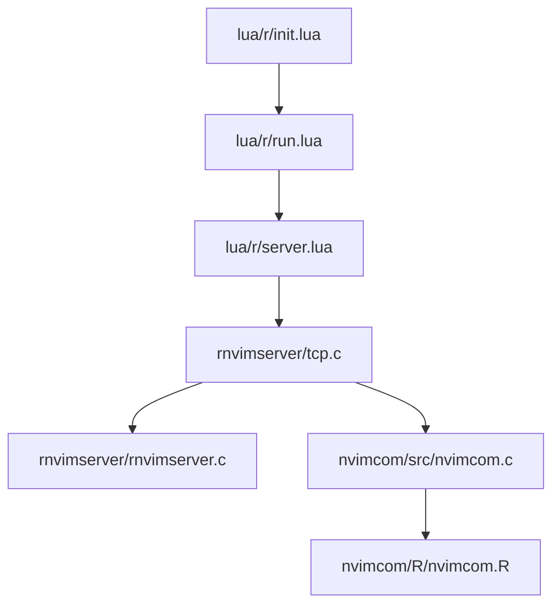

# R-nvim/R.nvim

> Neovim plugin for programming in R: console, object explorer, completion and Quarto.

## The problem
Editing R in Neovim without a console, without knowledge of the environment and without reliable completion.

## What it actually does
The repository contains a Lua plugin, the R package `nvimcom`, a language server in C (`rnvimserver`) and a tree-sitter parser for R output. Code is sent to an integrated R console or tmux. The package tells the server which objects and libraries are loaded, hence completion, object browser and help. Quarto, R Markdown and Rtypst are supported.

## How it is wired
Diagram based on the code diagram.


## Trying it
```bash
git clone --recurse-submodules https://github.com/R-nvim/R.nvim
```
Install through a plugin manager (lazy.nvim example in the README), then `:RMapsDesc` for the key mappings.

## Cost and gotchas
Free. Requires Neovim, R, a C compiler and the tree-sitter parsers. The API may still change between minor versions: pin the version.

## What it is not
It is not a full IDE like RStudio. Do not combine its completion with that of `languageserver`.

## Alternatives
The README mentions `languageserver` for completion.

## For you
Keep an eye on it: if you work in R from Neovim, it is the reference plugin; otherwise of no interest.
