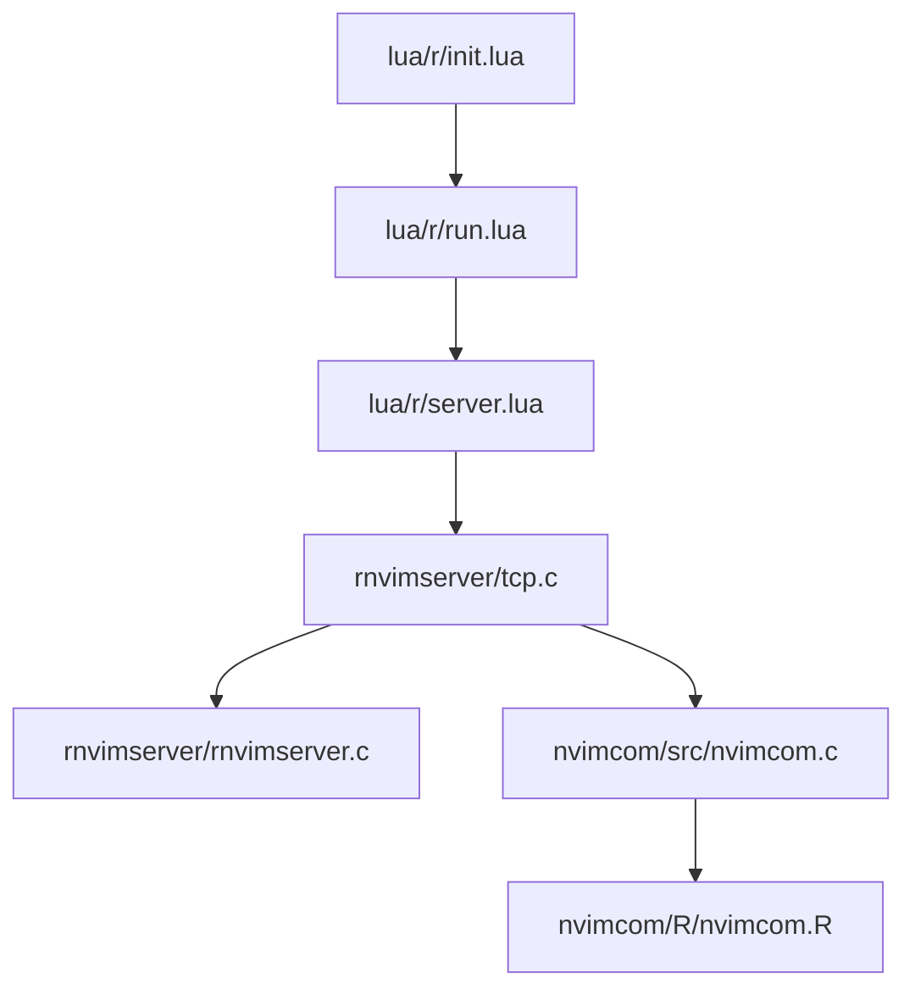

# R-nvim/R.nvim

> Plugin Neovim pour programmer en R : console, explorateur d'objets, complétion et Quarto.

## Le problème
Éditer du R dans Neovim sans console ni connaissance de l'environnement ni complétion fiable.

## Ce que ça fait vraiment
Le dépôt contient un plugin Lua, le paquet R `nvimcom`, un serveur de langage en C (`rnvimserver`) et un analyseur tree-sitter pour les sorties R. Le code part dans une console R intégrée ou tmux. Le paquet signale au serveur les objets et bibliothèques chargés, d'où complétion, navigateur d'objets et aide. Quarto, R Markdown et Rtypst sont gérés.

## Comment c'est branché
Schéma d'après le diagramme du code.


## Essayer
```bash
git clone --recurse-submodules https://github.com/R-nvim/R.nvim
```
Installation par gestionnaire de plugins (exemple lazy.nvim dans le README), puis `:RMapsDesc` pour les raccourcis.

## Coût et pièges
Gratuit. Il faut Neovim, R, un compilateur C et les analyseurs tree-sitter. L'API peut encore changer entre versions mineures : fixer la version.

## Ce que ce n'est pas
Ce n'est pas un IDE complet comme RStudio. Il ne faut pas cumuler sa complétion avec celle de `languageserver`.

## Alternatives
Le README cite `languageserver` pour la complétion.

## Pour toi
À surveiller : si tu travailles en R depuis Neovim, c'est le plugin de référence ; sinon sans intérêt.

