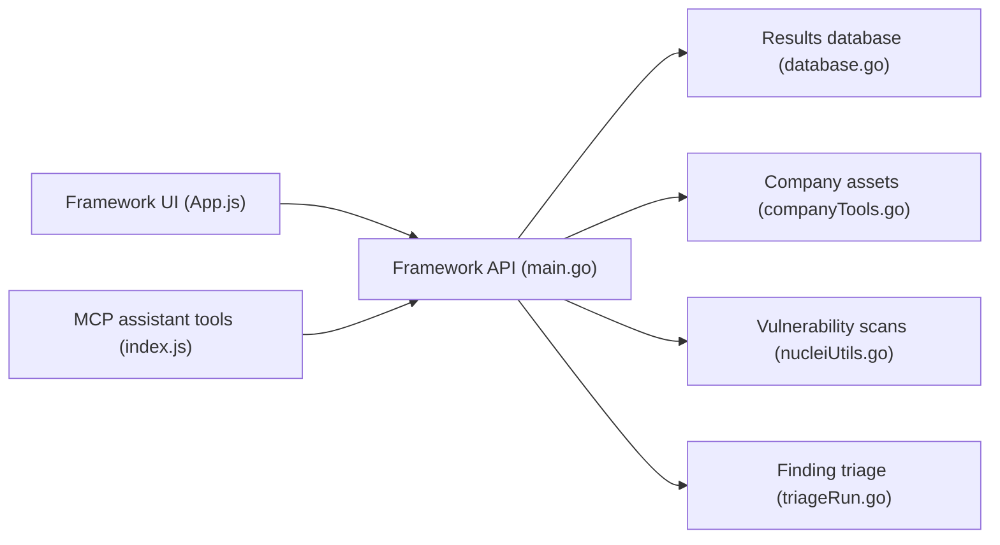

# R-s0n/ars0n-framework-v2

> Bug bounty platform that wraps 50+ reconnaissance tools in a guided methodology.

## The problem
Bug bounty beginners don't know in what order to chain the tools or which targets to prioritize after enumeration.

## What it actually does
More than 50 Docker containers behind an nginx: React interface, Go API, PostgreSQL database. Three flows (company, wildcard, URL) chain ASN, domains, subdomains, live servers, nuclei, etc. A ROI score ranks the targets. An MCP server with 142 tools (port 3001) lets an assistant launch scans. The educational URL flow is still under development.

## How it is wired


## Trying it
```bash
docker-compose up --build
curl http://localhost:3001/health
claude mcp add --transport sse ars0n-framework http://localhost:3001/sse
```

## Cost and gotchas
Free, but 8 GB of RAM minimum, 30 to 60 minutes for the first build, and keys (SecurityTrails, Censys, Shodan) that are paid beyond the free quotas. The MCP server has no authentication by default (`MCP_AUTH_TOKEN` must be set).

## What it is not
Not a general-purpose security tool: it is meant for testing authorized targets. Beta version 0.1.0; the educational URL flow is not finished.

## Alternatives
No alternative named in the README.

## For you
Ignore: an offensive reconnaissance tool outside the data/AI/MLOps scope; to be used only on targets you are authorized to test.
