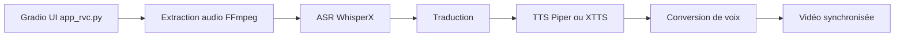

# R3gm/SoniTranslate

> Gradio interface that translates and dubs a video into another language, with transcription, TTS and synchronization.

## The problem
Dubbing a video into another language requires chaining audio extraction, transcription, translation, speech synthesis and re-assembly.

## What it actually does
A local web application (`app_rvc.py`, port 7860) that receives a video, transcribes with WhisperX and faster-whisper, segments speakers (pyannote), translates, generates the voice (Piper, Coqui XTTS, edge-tts, OpenAI optionally) then remixes with FFmpeg. A `--cpu_mode` option exists.

## How it is wired


## Trying it
```bash
conda create -n sonitr python=3.10 -y
conda activate sonitr
git clone https://github.com/r3gm/SoniTranslate.git
cd SoniTranslate
pip install -r requirements_base.txt -v
pip install -r requirements_extra.txt -v
export YOUR_HF_TOKEN="YOUR_HUGGING_FACE_TOKEN"
python app_rvc.py
```

## Cost and gotchas
CUDA 11.8, a Hugging Face account with the pyannote licenses accepted and a read token. An optional OpenAI key is billed to your account. The README only tests Linux.

## What it is not
Not an API nor a service: a local tool with 119 open issues. The README mixes "SoniTranslate" and "SonyTranslate" and opens with an advertisement for Recall.ai.

## Alternatives
No alternative named; the projects cited are its dependencies.

## For you
Keep an eye on it: an interesting ASR + TTS chain to study, but a single maintainer and a heavy installation (CUDA, tokens, pinned versions).
