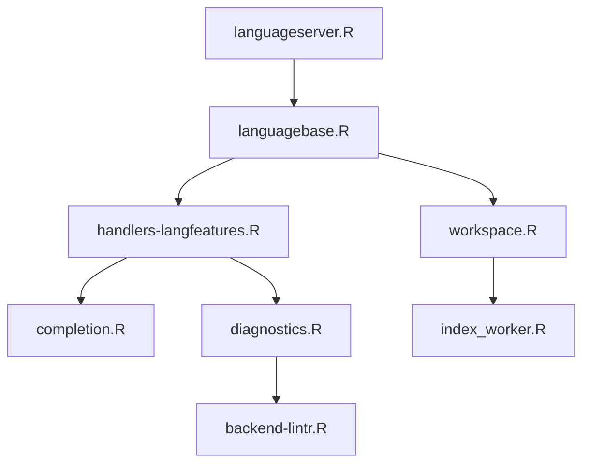

# REditorSupport/languageserver

> Language Server Protocol server for R: completion, diagnostics and refactoring in VS Code, Neovim, Emacs.

## The problem
Editors other than RStudio do not offer reliable completion, navigation and linting for R.

## What it actually does
Implements most LSP services: hover, completion, definitions, renaming, symbols, call hierarchies, semantic tokens and refactoring actions. Diagnostics and formatting go through lintr and styler, or jarl and air. Workspace indexing runs in the background.

## How it is wired


## Trying it
```bash
apt install --assume-yes --no-install-recommends build-essential libcurl4-openssl-dev libssl-dev libxml2-dev libuv1-dev r-base
```
```r
install.packages("languageserver")
install.packages(c("lintr", "styler"))
```

## Cost and gotchas
Free. Requires R and system libraries; R is not in the prerequisites list. License present but not identified by GitHub. Known limitation on R6 member inference.

## What it is not
Not an editor: it is a server to plug into an LSP client.

## Alternatives
No alternative named in the README.

## For you
Worth watching: essential if you write R outside RStudio, otherwise irrelevant for a Python profile.
