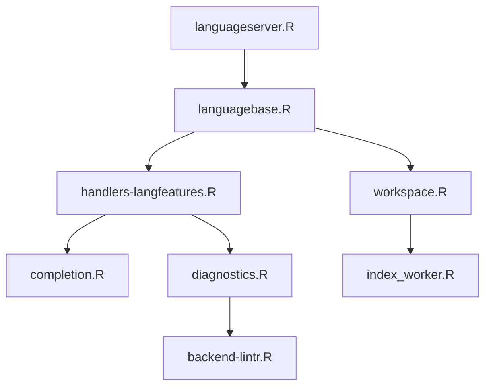

# REditorSupport/languageserver

> Serveur Language Server Protocol pour R : complétion, diagnostics et refactoring dans VS Code, Neovim, Emacs.

## Le problème
Les éditeurs autres que RStudio n'offrent pas de complétion, navigation et lint fiables pour R.

## Ce que ça fait vraiment
Implémente la plupart des services LSP : survol, complétion, définitions, renommage, symboles, hiérarchies d'appels, jetons sémantiques et actions de refactoring. Diagnostics et formatage passent par lintr et styler, ou jarl et air. L'indexation du workspace tourne en arrière-plan.

## Comment c'est branché


## Essayer
```bash
apt install --assume-yes --no-install-recommends build-essential libcurl4-openssl-dev libssl-dev libxml2-dev libuv1-dev r-base
```
```r
install.packages("languageserver")
install.packages(c("lintr", "styler"))
```

## Coût et pièges
Gratuit. Il faut R et des bibliothèques système ; R n'existe pas dans la liste des prérequis. Licence présente mais non identifiée par GitHub. Limite connue sur l'inférence des membres R6.

## Ce que ce n'est pas
Pas un éditeur : c'est un serveur à brancher sur un client LSP.

## Alternatives
Aucune alternative nommée dans le README.

## Pour toi
À surveiller : indispensable si tu écris du R hors RStudio, sinon sans objet pour un profil Python.

