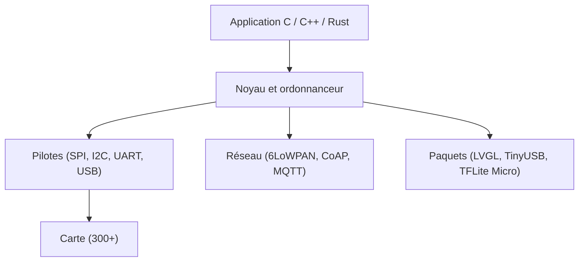

# RIOT-OS/RIOT

> Free operating system for 8-, 16- and 32-bit IoT microcontrollers, for embedded developers.

## The problem
Small connected devices need a frugal, real-time OS that is portable across boards.

## What it actually does
Preemptive kernel with a priority scheduler, uniform hardware API (partly POSIX), more than 300 boards, network stack (IPv6, 6LoWPAN, CoAP, MQTT, LwM2M), BLE, LoRaWAN, security (SUIT, PSA Crypto, DTLS). Programming in C, C++ or Rust; packages including TensorFlow Lite Micro and emlearn.

## How it is wired
Simplified diagram based on the sheet, no diagram provided.

## Trying it
No command in the README: it points to the Getting Started Guide (guide.riot-os.org).

## Cost and gotchas
Free. A cross-compilation toolchain and a target board are needed. LGPLv2.1, with possible linking of proprietary code. 908 open issues.

## What it is not
Not a system for servers or workstations. Not an ML platform: embedded ML goes through third-party packages.

## Alternatives
Ariel OS (IoT OS in Rust, a neighboring project cited by the README).

## For you
Ignore: an embedded OS outside the data / AI / MLOps scope, unless you do TinyML on a microcontroller.
