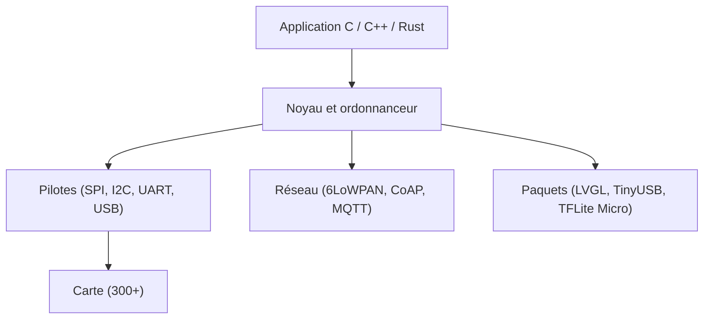

# RIOT-OS/RIOT

> Système d'exploitation libre pour microcontrôleurs IoT 8, 16 et 32 bits, pour développeurs embarqués.

## Le problème
Les petits appareils connectés demandent un OS économe, temps réel et portable entre cartes.

## Ce que ça fait vraiment
Noyau préemptif avec ordonnanceur à priorités, API matérielle uniforme (partiellement POSIX), plus de 300 cartes, pile réseau (IPv6, 6LoWPAN, CoAP, MQTT, LwM2M), BLE, LoRaWAN, sécurité (SUIT, PSA Crypto, DTLS). Programmation en C, C++ ou Rust ; paquets dont TensorFlow Lite Micro et emlearn.

## Comment c'est branché
Schéma simplifié d'après la fiche, sans diagramme fourni.

## Essayer
Aucune commande dans le README : renvoi vers le Getting Started Guide (guide.riot-os.org).

## Coût et pièges
Gratuit. Chaîne de compilation croisée et carte cible à prévoir. LGPLv2.1, avec liaison possible de code propriétaire. 908 issues ouvertes.

## Ce que ce n'est pas
Pas un système pour serveurs ou postes de travail. Pas une plateforme ML : le ML embarqué passe par des paquets tiers.

## Alternatives
Ariel OS (OS IoT en Rust, projet voisin cité par le README).

## Pour toi
Ignorer : OS embarqué hors périmètre data / IA / MLOps, sauf si tu fais du TinyML sur microcontrôleur.

