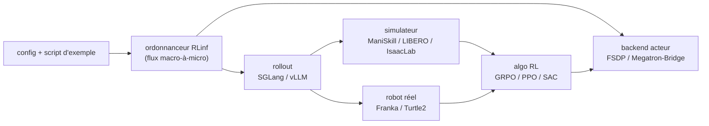

# RLinf/RLinf

> Distributed reinforcement learning infrastructure for embodied AI and agents, multi-simulator.

## The problem
Doing RL on VLA policies or agents means gluing together an inference engine, a training backend, a simulator and a multi-node scheduler — throwaway code for every combination.

## What it actually does
Provides RL workflows (PPO, GRPO, SAC, DAPO, IQL, DSRL…) while hiding distributed programming, and scales from 1 to N GPU nodes without changing the code. Two families of backends: FSDP + HuggingFace/SGLang/vLLM for prototyping, Megatron + SGLang/vLLM for scale. Covers SFT, RL in simulation (ManiSkill, LIBERO, IsaacLab, RoboTwin, Genesis…) and real-world RL (Franka, XSquare Turtle2, DOS-W1) with cameras and grippers declared. The hybrid execution mode is claimed to reach 2.434× the throughput of existing frameworks.

## How it is wired

## Trying it
No installation command is written in the README: it points to the installation guide and recommends the provided Docker image (method 1), then a ManiSkill3 example documented elsewhere. A library install via pip has been announced since 2026/02, with no command cited.

## Cost and gotchas
Free but heavy: GPUs required, and the embodied RL environment is described as complex — hence the recommended Docker image. Support is announced for MUSA (Moore Threads), CANN (Ascend) and ROCm, with a model/environment matrix to check before choosing your hardware.

## What it is not
Not a general-purpose text RLHF framework: the center of gravity is robotics and VLAs. Not a stable API: the news list shows a monthly breaking-change pace and 0.x versions.

## Alternatives
No named competitor: the README cites its building blocks (SGLang, vLLM, Megatron-Bridge, AgentLightning) and its adopters, not replacements.

## For you
Follow from a distance unless you do robotics RL; the systems engineering is the real contribution.
