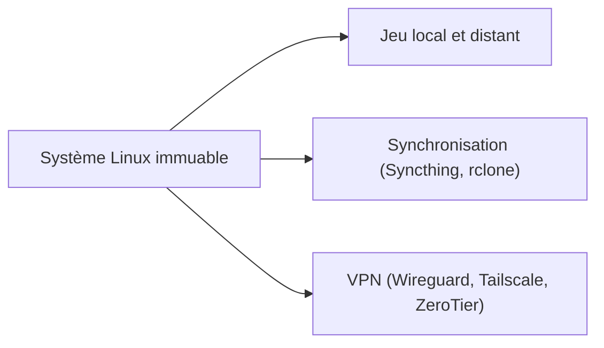

# ROCKNIX/distribution

> Immutable Linux distribution for handheld gaming consoles, developed by a small community.

## The problem
Handheld consoles need a ready-made system for emulation, battery and controllers.

## What it actually does
Immutable Linux system with local and remote play, touch, battery/performance settings, music and video, Bluetooth, HDMI output, synchronization (Syncthing, rclone), VPN (Wireguard, Tailscale, ZeroTier), scraping and RetroAchievements. Original software under GPL v2; bundled components keep their own license.

## How it is wired
Simplified diagram based on the fiche, no diagram provided.

## Trying it
No command documented in the README.

## Cost and gotchas
Free. Per-device compatibility is not specified in the README.

## What it is not
Not a general-purpose system: it targets handheld consoles.

## Alternatives
No alternative named in the README (JELOS and CoreELEC are cited as sources of inspiration).

## For you
Ignore: system for gaming consoles, outside data/AI/MLOps.
