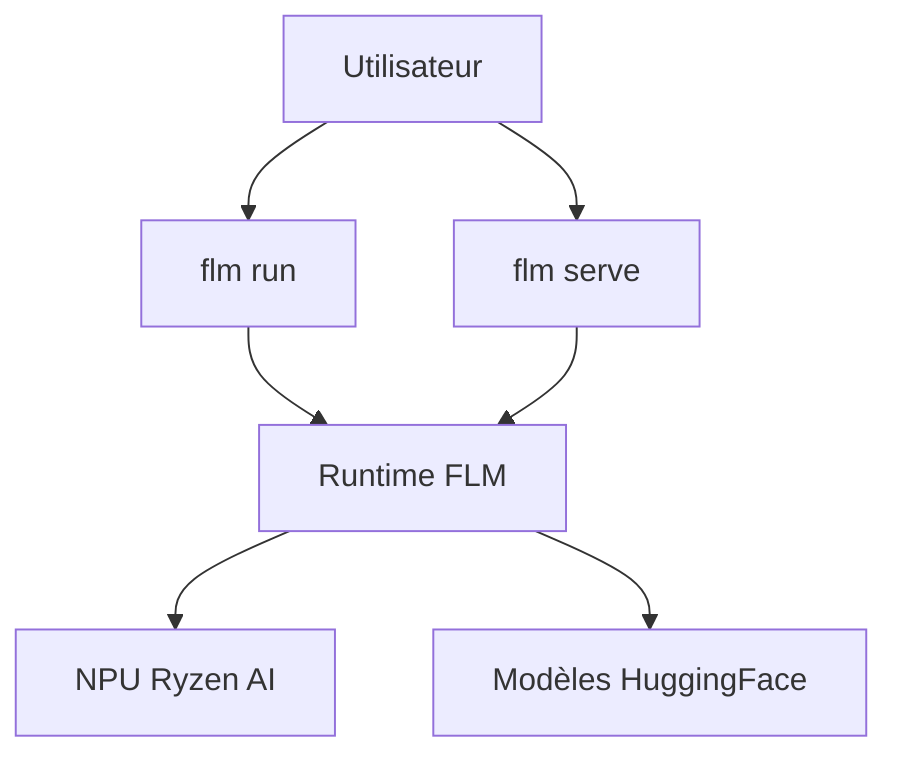

# ROCm/FastFlowLM

> LLM inference runtime on AMD Ryzen AI NPU, with a CLI and an OpenAI-compatible server.

## The problem
Running an LLM locally without a GPU, taking advantage of the NPU in Ryzen AI chips, is poorly tooled.

## What it actually does
The README is identical to that of FastFlowLM/FastFlowLM (same stars and same push date): probably the same project under a different owner. It runs LLMs, vision, audio and embeddings on the NPU, via CLI or as a REST server on port 52625. The code is not described here: no architecture provided.

## How it is wired
Simplified diagram based on the sheet, no diagram provided.



## Trying it
```bash
flm run llama3.2:1b
flm serve llama3.2:1b
flm list
```

## Cost and gotchas
Ryzen AI XDNA2 chip and NPU driver 32.0.203.311 or later; models downloaded from HuggingFace. License not identified by GitHub.

## What it is not
Not multi-hardware: AMD Ryzen AI only. Apparent duplicate of FastFlowLM/FastFlowLM, not to be counted twice.

## Alternatives
No alternative named in the README.

## For you
Worth watching if you have a Ryzen AI PC: same verdict as FastFlowLM, of which this repository appears to be the mirror.
