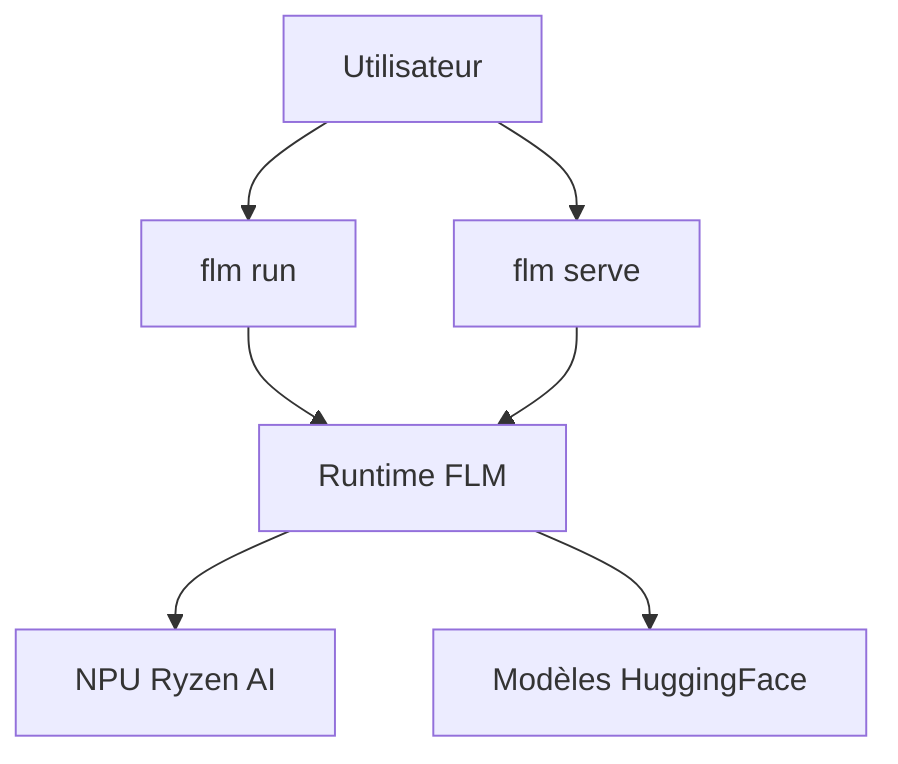

# ROCm/FastFlowLM

> Runtime d'inférence de LLM sur NPU AMD Ryzen AI, avec CLI et serveur compatible OpenAI.

## Le problème
Faire tourner un LLM en local sans GPU en profitant du NPU des puces Ryzen AI est mal outillé.

## Ce que ça fait vraiment
Le README est identique à celui de FastFlowLM/FastFlowLM (mêmes étoiles et même date de push) : sans doute le même projet sous un autre propriétaire. Il exécute des LLM, vision, audio et embeddings sur NPU, en CLI ou en serveur REST sur le port 52625. Le code n'est pas décrit ici : pas d'architecture fournie.

## Comment c'est branché
Schéma simplifié d'après la fiche, sans diagramme fourni.



## Essayer
```bash
flm run llama3.2:1b
flm serve llama3.2:1b
flm list
```

## Coût et pièges
Puce Ryzen AI XDNA2 et pilote NPU 32.0.203.311 ou plus ; modèles téléchargés depuis HuggingFace. Licence non identifiée par GitHub.

## Ce que ce n'est pas
Pas multi-matériel : AMD Ryzen AI uniquement. Doublon apparent de FastFlowLM/FastFlowLM, à ne pas compter deux fois.

## Alternatives
Aucune alternative nommée dans le README.

## Pour toi
À surveiller si tu as un PC Ryzen AI : même verdict que FastFlowLM, dont ce dépôt semble le miroir.

