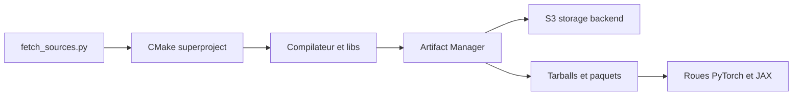

# ROCm/TheRock

> Build and release system for HIP and ROCm, with PyTorch and JAX nightlies for AMD GPUs.

## The problem
Building ROCm by hand, component by component, is slow and fragile; installing recent PyTorch versions on AMD GPUs is too.

## What it actually does
A CMake super-project that fetches the sources of the ROCm components, compiles them (compiler, math libraries, communication, vision, ML, debug tools) and publishes tarballs, Linux packages and Python wheels. ROCm, PyTorch and JAX nightlies. Since ROCm 7.14, ROCm is published from this repository. Linux and native Windows.

## How it is wired


## Trying it
```bash
git clone https://github.com/ROCm/TheRock.git
cd TheRock
python3 -m venv .venv && source .venv/bin/activate
pip install -r requirements.txt
python3 ./build_tools/fetch_sources.py
cmake -B build -GNinja . -DTHEROCK_AMDGPU_FAMILIES=gfx110X-all
cmake --build build
```

## Cost and gotchas
About 200 GB of disk and several hours of compilation; a disk failure breaks the build. You must choose `THEROCK_AMDGPU_FAMILIES` or `THEROCK_AMDGPU_TARGETS`. The README recommends ccache and preferring releases when they exist.

## What it is not
Not a simple installer: to use ROCm without compiling it, go through the Releases page. 1,271 open issues.

## Alternatives
No alternative named in the README.

## For you
Watch: the PyTorch/JAX nightlies on AMD matter if you deploy on AMD GPUs; the full build remains contributor work.
