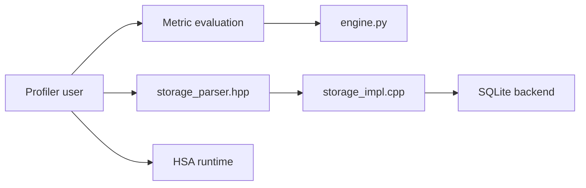

# ROCm/rocm-systems

> Super-repository gathering the ROCm systems projects (runtime, profiling, AMD GPU tools) to build PyTorch.

## The problem
The ROCm system components lived in many repositories, which complicated CI and integration.

## What it actually does
Consolidates `amdsmi`, `clr`, `hip`, `rocprofiler-*`, `rocdecode`, `rocr-runtime`, `rocshmem`, `roctracer` and others under `projects/`, with a migration and CI status table. The repository becomes the source of truth for migrated components. The code excerpt shows profiling analysis, SQLite trace storage and GPU emulation.

## How it is wired

## Trying it
No command in the README; it points to CONTRIBUTING.md (sparse-checkout, development workflow).

## Cost and gotchas
AMD hardware required. Huge repository (1,682 open issues): sparse-checkout is recommended. No license declared in the catalog, whereas each project has its own.

## What it is not
Not an application nor a single product: a monorepo of components. The remaining migration schedule is not defined.

## Alternatives
No alternative named in the README.

## For you
Worth watching: useful if you run PyTorch on AMD GPUs, otherwise to consult only for profiling; license to check per component.
