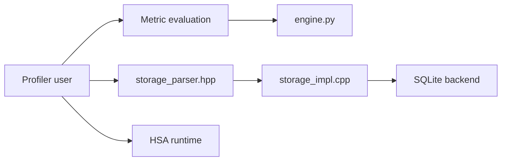

# ROCm/rocm-systems

> Super-dépôt regroupant les projets systèmes ROCm (runtime, profilage, outils GPU AMD) pour compiler PyTorch.

## Le problème
Les composants systèmes ROCm vivaient dans de nombreux dépôts, ce qui compliquait CI et intégration.

## Ce que ça fait vraiment
Consolide `amdsmi`, `clr`, `hip`, `rocprofiler-*`, `rocdecode`, `rocr-runtime`, `rocshmem`, `roctracer` et d'autres sous `projects/`, avec un tableau de statut de migration et de CI. Le dépôt devient la source de vérité pour les composants migrés. L'extrait de code montre analyse de profilage, stockage de traces SQLite et émulation GPU.

## Comment c'est branché

## Essayer
Aucune commande dans le README ; il renvoie à CONTRIBUTING.md (sparse-checkout, workflow de développement).

## Coût et pièges
Matériel AMD requis. Dépôt énorme (1 682 issues ouvertes) : le sparse-checkout est recommandé. Aucune licence déclarée au catalogue, alors que chaque projet a la sienne.

## Ce que ce n'est pas
Pas une application ni un produit unique : un monorepo de composants. Le calendrier de migration restant n'est pas défini.

## Alternatives
Aucune alternative nommée dans le README.

## Pour toi
À surveiller : utile si tu fais tourner PyTorch sur GPU AMD, sinon à consulter seulement pour le profilage ; licence à vérifier par composant.

