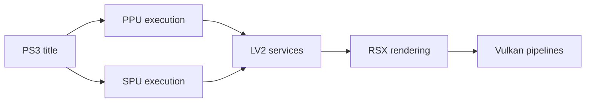

# RPCS3/rpcs3

> Open-source PlayStation 3 emulator and debugger in C++ for Windows, Linux, macOS and FreeBSD.

## The problem
Running PlayStation 3 games on a PC: RPCS3 is an open-source emulator and debugger, unrelated to data or AI.

## What it actually does
Runs the guest PPU/SPU code (JIT translators), provides the LV2 system services and Cell modules, guest memory, file systems, input, audio, network, trophies. RSX rendering is translated to OpenGL or Vulkan, with a GDB debugger. The README is short and points to the website, the wiki and the quick-start guide.

## How it is wired

## Trying it
No command in the README: see `BUILDING.md` and the quick-start guide.

## Cost and gotchas
Up-to-date graphics driver, Visual C++ Redistributable 2022 on Windows. Strict policy on AI-generated code: disclosure is mandatory in PRs.

## What it is not
Not a data/AI tool; does not provide games.

## Alternatives
None named in the README.

## For you
Ignore: console emulator, outside the data / AI / MLOps scope.
