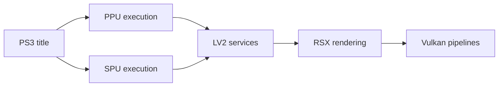

# RPCS3/rpcs3

> Émulateur et débogueur PlayStation 3 open source en C++ pour Windows, Linux, macOS et FreeBSD.

## Le problème
Faire tourner des jeux PS3 sur PC.

## Ce que ça fait vraiment
Exécute le code invité PPU/SPU (traducteurs JIT), fournit les services système LV2 et les modules Cell, mémoire invitée, systèmes de fichiers, entrées, audio, réseau, trophées. Rendu RSX traduit vers OpenGL ou Vulkan, débogueur GDB. Le README est court et renvoie au site, au wiki et au guide de démarrage rapide.

## Comment c'est branché

## Essayer
Aucune commande dans le README : voir `BUILDING.md` et le guide de démarrage rapide.

## Coût et pièges
Pilote graphique à jour, Visual C++ Redistributable 2022 sous Windows. Politique stricte sur le code généré par IA : divulgation obligatoire dans les PR.

## Ce que ce n'est pas
Pas un outil data/IA ; ne fournit pas de jeux.

## Alternatives
Aucune nommée dans le README.

## Pour toi
Ignorer : émulateur de console, hors périmètre data / IA / MLOps.

