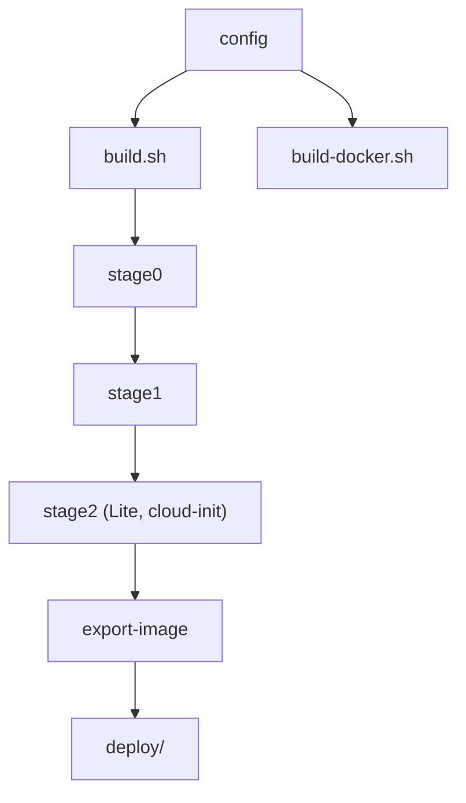

# RPi-Distro/pi-gen

> Tool for generating Raspberry Pi OS images, official or custom, for anyone preparing SD cards.

## The problem
Building a reproducible Raspberry Pi OS image by hand, with its packages and configuration, takes a long time.

## What it actually does
Shell scripts that build a filesystem in stages (stage0 to stage5: bootstrap, bootable, Lite, desktop, normal, full), then export an image or a NOOBS bundle. A `config` file sets the name, Debian version, user, SSH, cloud-init. A Docker mode exists.

## How it is wired


## Trying it
```bash
git clone https://github.com/RPI-Distro/pi-gen.git
echo "IMG_NAME='raspios'" > config
sudo ./build.sh
./build-docker.sh
```

## Cost and gotchas
Free. The working directory takes tens of GB, and must not be on NTFS. Docker mode requires a privileged container. SSH is disabled by default; password and passwordless sudo are documented security risks. Use the `arm64` branch for 64-bit.

## What it is not
Not a tool for configuring an already installed Pi. Not designed for Windows or for paths with spaces.

## Alternatives
No alternative cited in the README.

## For you
Watch: useful if you deploy Raspberry Pis for edge AI or sensors with a reproducible image, otherwise irrelevant.
