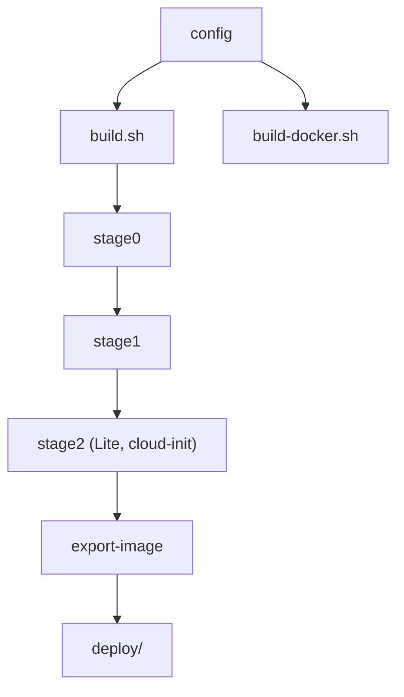

# RPi-Distro/pi-gen

> Outil de génération d'images Raspberry Pi OS, officielles ou personnalisées, pour qui prépare des cartes SD.

## Le problème
Fabriquer à la main une image Raspberry Pi OS reproductible, avec ses paquets et sa configuration, est long.

## Ce que ça fait vraiment
Scripts shell qui construisent un système de fichiers par étapes (stage0 à stage5 : amorçage, bootable, Lite, bureau, normal, complet), puis exportent une image ou un lot NOOBS. Fichier `config` pour nom, version Debian, utilisateur, SSH, cloud-init. Un mode Docker existe.

## Comment c'est branché


## Essayer
```bash
git clone https://github.com/RPI-Distro/pi-gen.git
echo "IMG_NAME='raspios'" > config
sudo ./build.sh
./build-docker.sh
```

## Coût et pièges
Gratuit. Le répertoire de travail prend des dizaines de Go, hors NTFS. Le mode Docker demande un conteneur privilégié. Par défaut SSH est désactivé ; mot de passe et sudo sans mot de passe sont des risques de sécurité documentés. Branche `arm64` pour le 64 bits.

## Ce que ce n'est pas
Pas un outil de configuration d'un Pi déjà installé. Pas fait pour Windows ni pour des chemins avec espaces.

## Alternatives
Aucune alternative citée dans le README.

## Pour toi
Surveiller : utile si tu déploies des Raspberry Pi en edge IA ou en capteurs avec une image reproductible, sinon sans objet.

