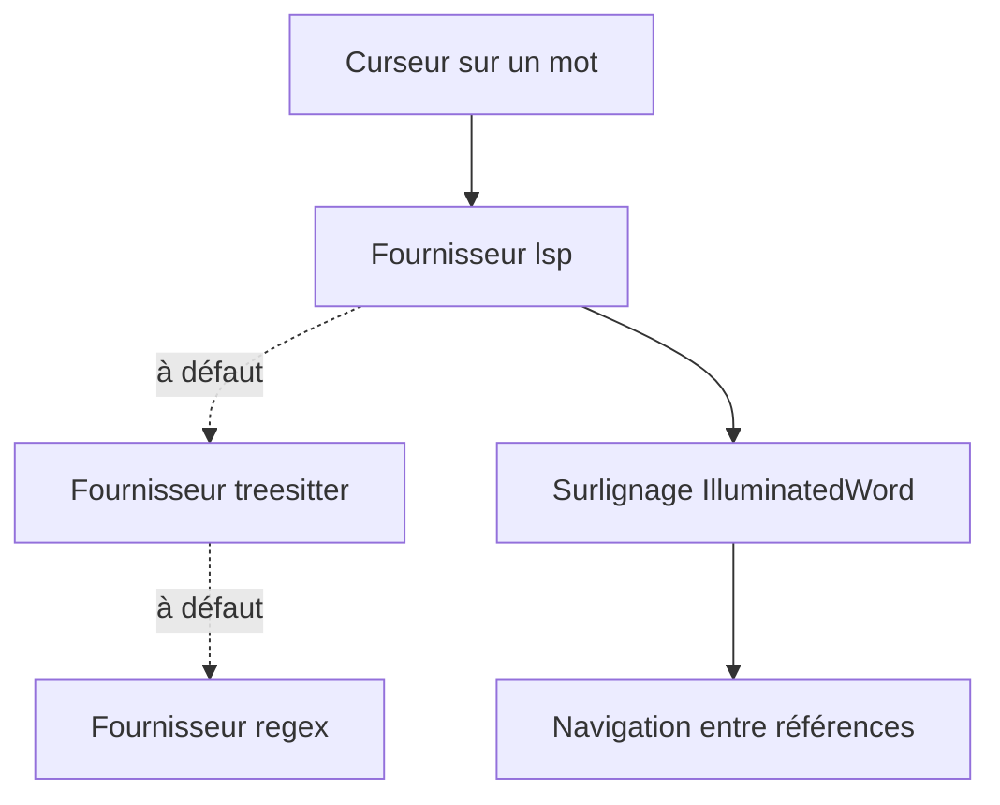

# RRethy/vim-illuminate

> Neovim plugin that highlights the other occurrences of the word under the cursor, via LSP, Tree-sitter or regex.

## The problem
Finding where a variable is used in a file forces you to search by hand.

## What it actually does
Automatically highlights the references of the word under the cursor, with three providers by priority (LSP, Tree-sitter, regex). Adds shortcuts to jump from one reference to another and a text object to select it. Configured through file type and mode filters, with pause commands. An older version exists for Vim.

## How it is wired
Simplified schema based on the sheet, no diagram provided.



## Trying it
```lua
require('illuminate').configure({
    providers = { 'lsp', 'treesitter', 'regex' },
    delay = 100,
})
```
Without configuration, the plugin already works once installed.

## Cost and gotchas
Free. Neovim required for the recent version. On large files (more than 10,000 lines by default), the plugin disables itself unless specifically configured.

## What it is not
Not a refactoring tool: it highlights, it does not rename. Not for editors other than Neovim and Vim.

## Alternatives
No alternative named in the README.

## For you
Ignore unless you code in Neovim: editing comfort, with no effect on data / AI work in itself.
