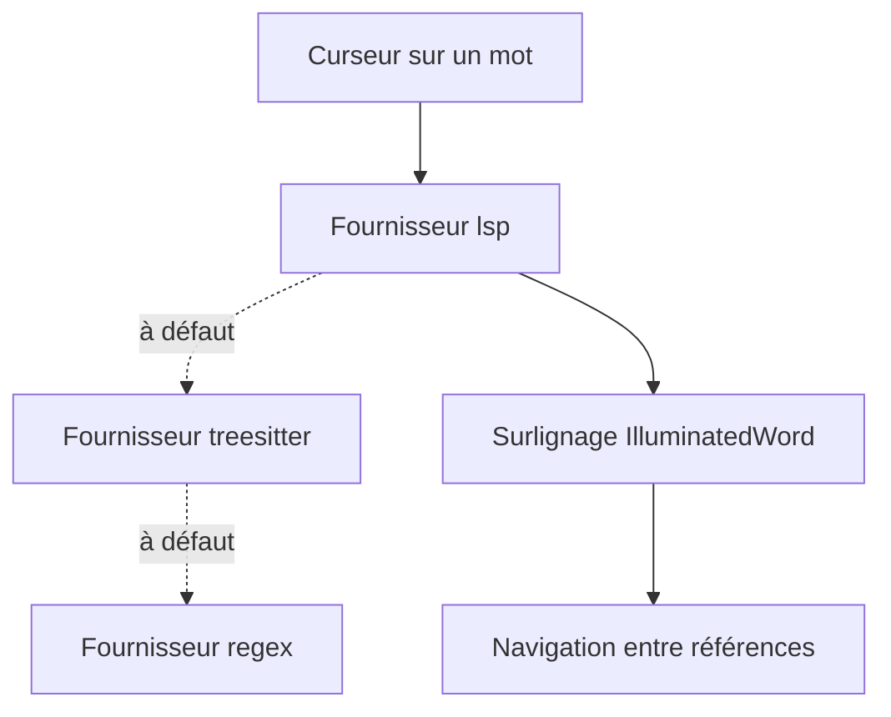

# RRethy/vim-illuminate

> Plugin Neovim qui surligne les autres occurrences du mot sous le curseur, via LSP, Tree-sitter ou regex.

## Le problème
Repérer où une variable est utilisée dans un fichier oblige à chercher à la main.

## Ce que ça fait vraiment
Surligne automatiquement les références du mot sous le curseur, avec trois fournisseurs par priorité (LSP, Tree-sitter, regex). Ajoute des raccourcis pour passer d'une référence à l'autre et un objet texte pour la sélectionner. Se règle par filtres de types de fichiers et de modes, avec des commandes de pause. Une ancienne version existe pour Vim.

## Comment c'est branché
Schéma simplifié d'après la fiche, sans diagramme fourni.



## Essayer
```lua
require('illuminate').configure({
    providers = { 'lsp', 'treesitter', 'regex' },
    delay = 100,
})
```
Sans configuration, le plugin fonctionne déjà une fois installé.

## Coût et pièges
Gratuit. Neovim requis pour la version récente. Sur de gros fichiers (plus de 10 000 lignes par défaut), le plugin se désactive sauf réglage dédié.

## Ce que ce n'est pas
Pas un outil de refactoring : il surligne, il ne renomme pas. Pas pour d'autres éditeurs que Neovim et Vim.

## Alternatives
Aucune alternative nommée dans le README.

## Pour toi
À ignorer sauf si tu codes sous Neovim : confort d'édition, sans effet sur un travail data / IA en soi.

