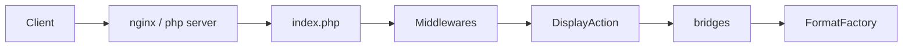

# RSS-Bridge/rss-bridge

> PHP web application that builds RSS/Atom feeds for sites that do not offer any.

## The problem
Many sites and social networks have removed their feeds: you cannot follow them in an RSS reader.

## What it actually does
Nearly 450 "bridges" (YouTube, Reddit, Telegram, Mastodon, XPath, CSS selectors, filters, feed merging...) fetch the content and return it as Atom, JSON, HTML, MRSS, text or Sfeed. Cache (file, SQLite, Memcached), token or Basic authentication, errors rendered as feed items.

## How it is wired


## Trying it
```bash
docker create --name=rss-bridge --publish 3000:80 --volume $(pwd)/config:/config rssbridge/rss-bridge
docker start rss-bridge
```
Then http://localhost:3000/.

## Cost and gotchas
Free, Unlicense. PHP 7.4 minimum outside Docker. Bridges break when the target site changes; the Heroku deployment no longer works.

## What it is not
Not an RSS reader: it only produces feeds. The README contains a polemical text at the end.

## Alternatives
No alternative named in the README (other public instances are listed).

## For you
Adopt: handy for feeding a watch from sources without feeds, to host at home.
