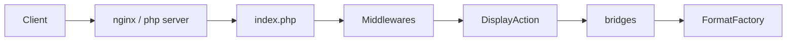

# RSS-Bridge/rss-bridge

> Application web PHP qui fabrique des flux RSS/Atom pour des sites qui n'en proposent pas.

## Le problème
De nombreux sites et réseaux sociaux ont supprimé leurs flux : impossible de les suivre dans un lecteur RSS.

## Ce que ça fait vraiment
Près de 450 « bridges » (YouTube, Reddit, Telegram, Mastodon, XPath, sélecteurs CSS, filtres, fusion de flux…) récupèrent le contenu et le renvoient en Atom, JSON, HTML, MRSS, texte ou Sfeed. Cache (fichier, SQLite, Memcached), authentification par jeton ou Basic, erreurs rendues sous forme d'éléments de flux.

## Comment c'est branché


## Essayer
```bash
docker create --name=rss-bridge --publish 3000:80 --volume $(pwd)/config:/config rssbridge/rss-bridge
docker start rss-bridge
```
Puis http://localhost:3000/.

## Coût et pièges
Gratuit, Unlicense. PHP 7.4 minimum hors Docker. Les bridges cassent quand le site cible change ; le déploiement Heroku ne fonctionne plus.

## Ce que ce n'est pas
Pas un lecteur RSS : il ne produit que des flux. Le README contient un texte polémique à la fin.

## Alternatives
Aucune alternative nommée dans le README (d'autres instances publiques sont listées).

## Pour toi
Adopter : pratique pour alimenter une veille à partir de sources sans flux, à héberger chez toi.

